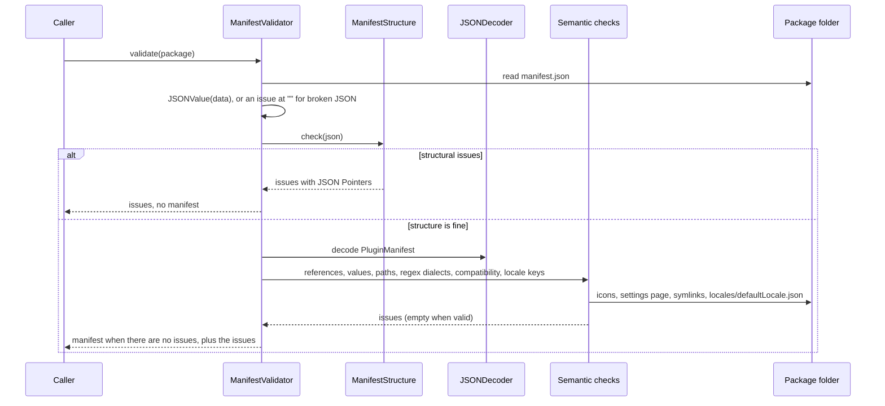

# 01 · Plugin package and manifest

Part of the [Baron Plugin Platform design](README.md).

A plugin is a folder with `manifest.json` at its root. The manifest says what the plugin is, which actions it adds to the bar, what it needs, and what users can set, and Baron reads all of it without running any plugin code.

**Scope.** In: the package layout, every manifest field, the JSON Schema and the Swift validator, `when` rules, localisation, versioning. Out: rendering preferences ([06](06-settings.md)), installing packages ([10](10-install-and-lifecycle.md)).

## Package layout

```text
org.odh.dictionary/
  manifest.json            required
  dist/main.js             required: the bundled plugin code (built by `baron build`)
  views/                   optional: web pages and their assets (07)
  assets/icon.svg          optional: icons, SVG only
  locales/en.json          optional: translated strings, one file per language
  locales/zh-Hans.json
  README.md, LICENSE       optional
```

During development the package is a plain folder. To share it, `baron pack` zips it as `<id>-<version>.baronplugin`.

## Manifest

```json
{
  "$schema": "https://baron.dev/schema/manifest-1.json",
  "id": "org.odh.dictionary",
  "name": "%name%",
  "description": "%description%",
  "version": "1.0.0",
  "apiVersion": 1,
  "author": "ODH contributors",
  "homepage": "https://github.com/ninja33/ODH",
  "license": "MIT",
  "defaultLocale": "en",
  "main": "dist/main.js",
  "icon": "assets/icon.svg",
  "platforms": ["macos", "windows", "linux"],
  "permissions": ["context.sentence", "context.page", "network:127.0.0.1:8765", "secrets"],
  "optionalPermissions": ["network:*"],
  "preferences": [ { "id": "deck", "type": "dropdown", "title": "%pref.deck%", "optionsFrom": "decks" } ],
  "actions": [
    {
      "id": "lookup",
      "title": "%action.lookup%",
      "icon": "assets/lookup.svg",
      "when": { "maxLength": 64, "contentTypes": ["word", "text"] },
      "needs": ["sentence", "page"],
      "autoRun": "allowed"
    }
  ]
}
```

| Field | Required | Meaning |
| --- | --- | --- |
| `id` | Yes | Reverse-DNS, lowercase, unique. Never changes between versions |
| `name`, `description` | Yes | Shown in Settings and at install; may be `%key%` references to `locales/` |
| `version` | Yes | Semantic version; a higher version is an update |
| `apiVersion` | Yes | The host API generation the plugin targets; currently `1` |
| `author`, `homepage`, `license` | No | Shown at install |
| `defaultLocale` | If `%key%` is used | The language used when the user's isn't available |
| `main` | Yes | The bundled code, relative to the package |
| `icon` | No | SVG; also the default action icon |
| `platforms` | No | Defaults to all three; a host refuses a plugin that excludes it |
| `minBaronVersion` | No | Refuse to install on older Baron |
| `permissions` | No | Granted at install ([04](04-permissions-and-security.md)) |
| `optionalPermissions` | No | Asked for at run time ([04](04-permissions-and-security.md)) |
| `preferences` | No | Settings Baron draws ([06](06-settings.md)) |
| `settingsPage` | No | A web page shown under the generated settings ([07](07-web-views.md)) |
| `settingsView` | No | Reserved for a native settings view ([08](08-native-views.md), after ODH) |
| `actions` | Yes, at least one | Buttons on the bar |

## Actions

| Field | Meaning |
| --- | --- |
| `id` | Unique within the plugin; also the exported handler's name unless `run` says otherwise |
| `run` | The handler's export name, if different from `id` |
| `title` | Button label (tooltip when the bar shows icons only) |
| `icon` | SVG in the package; falls back to the plugin icon |
| `when` | Rules that decide whether the button appears (below) |
| `needs` | Context the handler reads: any of `sentence`, `paragraph`, `page`, `window`. Each must also be granted as a permission. Baron reads only what some matching action needs, so selections stay fast |
| `autoRun` | `"allowed"` (or the default, `"never"`) lets the user switch this action to run straight after a selection instead of showing a button. Off by default; only for actions without side effects, such as lookups |

## `when` rules

Baron checks these in Swift for every selection, before loading any plugin. All rules must hold; a missing rule doesn't constrain.

| Rule | Type | Holds when |
| --- | --- | --- |
| `minLength`, `maxLength` | integer | The trimmed text's length, in UTF-16 units, is within bounds |
| `regex` | string | The pattern is found anywhere in the trimmed text, as with JavaScript's `RegExp.test`; use `^` and `$` to match all of it. ECMAScript syntax with the `u` flag; the validator rejects patterns that don't compile in both JavaScript and ICU (for example `(?i)` or `[]`) |
| `contentTypes` | array | The text is one of: `word` (letters, with apostrophes or hyphens between them: `don't`, `well-known`, `狐狸`), `url` (one whole http or https link, a bare domain counts), `email`, `number` (optional sign, thousands separators, fraction and `%`), `text` (anything not empty) |
| `apps`, `excludeApps` | array | The source app is (not) listed for this platform. Entries are bundle IDs (macOS), or `{ "macos": "…", "windows": "…" }`. An unknown app matches no entry |
| `editable` | boolean | The selection can be replaced |

## Localisation

Any user-visible string (names, titles, descriptions, labels, placeholders, option titles) may be `%key%`, written as the whole string; `100%` stays text. Baron looks the key up in `locales/<language>.json`, a flat key-to-string map, trying the user's preferred languages in order with subtags dropped one at a time (`zh-Hans-CN`, then `zh-Hans`, then `zh`), then `defaultLocale`, then shows the key itself. Plugin code reads the language from `host.environment.locale` and translates its own UI.

## Validation

- **One schema, two checkers.** `@baron/api` publishes the JSON Schema (draft 2020-12). Baron's Swift validator decodes the same manifest and adds checks a schema can't express.
- **The schema is strict.** Unknown fields are errors, so typos surface at build time. Permission names, network patterns, paths (relative, no `.` or `..` parts, icons ending `.svg`, `main` ending `.js`) and IDs are checked by the schema itself, with patterns ICU reads the same way.
- **Checks beyond the schema**, in Baron's validator: action and preference IDs are unique; `dependsOn` names another preference; each `needs` entry is granted as a `context.*` permission; `regex`, `pattern` and `itemPattern` compile in both dialects; `minLength` ≤ `maxLength` and defaults fall within their range or fixed options; `apiVersion`, `minBaronVersion` and `platforms` suit this Baron; the icon, action icons and settings page exist and no symlink leads out of the package (`main` is build output, so it is checked only once it exists, and again at install); `defaultLocale` has its file and every `%key%` is in it.
- **Errors name the field** with a JSON Pointer (`/actions/0/when/regex`), in Baron's install sheet and in `baron build`. A missing or unknown field is named where it would be (`/id`); a dropdown with both or neither of `options` and `optionsFrom` is named by the preference (`/preferences/3`).
- **One corpus keeps them in step.** `packages/api/test/corpus/` holds 58 plugin folders, each with one defect (or none) and the pointer it must produce; `bun test` runs them against the schema and the Swift tests against Baron's validator.

## Versioning

`apiVersion` is a whole number. Baron runs plugins targeting the current and the previous number and refuses newer ones with a clear message. Any change to a manifest field's meaning, a host method, or the render-tree format starts a new number.

## Interfaces

The runtime ([02](02-runtime.md)) loads `main`; permissions ([04](04-permissions-and-security.md)) read `permissions` and `optionalPermissions`; settings ([06](06-settings.md)) render `preferences`; web views ([07](07-web-views.md)) serve `views/`; tooling ([09](09-developer-tooling.md)) generates and validates manifests; install ([10](10-install-and-lifecycle.md)) reads `id`, `version`, `platforms`, `minBaronVersion`.

## Risks

- **Regex dialects differ** between JavaScript and ICU. The validator compiles each `regex` in both and the shared test corpus covers common patterns.
- **The manifest grows.** New fields are optional, and anything that changes meaning waits for the next `apiVersion`.

## UML

Drawn from the code at the end of task-004: `@baron/api` in `packages/api`, Baron's side in `macos/Sources/BaronCore/Plugins`. How the bar picks actions with these rules is drawn in task-005, which builds it.

```mermaid
classDiagram
  namespace baron_api {
    class PluginManifestTS["PluginManifest (TypeScript)"] {
      types for every field
    }
    class ManifestSchema["schema/manifest-1.json"] {
      draft 2020-12, strict
    }
    class definePlugin {
      +definePlugin(definition) definition
    }
    class BaronError {
      +code: ErrorCode
      +data
      +isBaronError(error, code?)$ Bool
    }
  }
  namespace BaronCore {
    class ManifestValidator {
      +environment: ManifestEnvironment
      +validate(package: URL) ManifestValidation
      +validate(data, package) ManifestValidation
    }
    class ManifestEnvironment {
      +baronVersion: String
      +platform: PluginPlatform
      +apiVersions: ClosedRange~Int~
    }
    class ManifestValidation {
      +manifest: PluginManifest?
      +issues: [ManifestIssue]
    }
    class ManifestIssue {
      +pointer: String
      +message: String
    }
    class JSONValue {
      <<enumeration>>
      null, bool, number, string, array, object
    }
    class ManifestStructure {
      +check(JSONValue)$ [ManifestIssue]
    }
    class Shape {
      <<enumeration>>
      string, integer, number, boolean, array, object, either, preference
      +check(value, at: JSONPointer, into: issues)
    }
    class PluginManifest {
      +id, name, version, apiVersion, main
      +platforms: [PluginPlatform]
      +permissions: [String]
      +preferences: [Preference]
      +actions: [Action]
    }
    class WhenRules {
      +minLength, maxLength, regex
      +contentTypes: [ContentType]?
      +apps, excludeApps: [AppMatch]?
      +editable: Bool?
      +matches(WhenInput) Bool
    }
    class WhenInput {
      +text: String (trimmed)
      +bundleIdentifier: String?
      +editable: Bool
      +platform: PluginPlatform
    }
    class ContentClassifier {
      +types(of: text)$ Set~ContentType~
    }
    class RegexCache {
      +regex(for: pattern) NSRegularExpression?
    }
    class SemanticChecks["ManifestReferenceChecks, ManifestValueChecks, PackagePathChecks, RegexDialectChecks, CompatibilityChecks, LocaleReferenceChecks"] {
      +check(manifest, ...)$ [ManifestIssue]
    }
    class JavaScriptRegexCompiler {
      -context: JSContext
      +error(compiling: pattern) String?
    }
    class SemanticVersion {
      +major, minor, patch, prerelease
      +compare by semver precedence
    }
    class PluginLocales {
      +key(in: text)$ String?
      +table(for: language, in: package)$
    }
    class PluginLocalizer {
      +resolve(text) String
    }
  }
  ManifestSchema .. ManifestStructure : same rules, same pointers (shared corpus)
  PluginManifestTS .. ManifestSchema : same fields (schema-sync test)
  ManifestValidator --> ManifestEnvironment
  ManifestValidator ..> ManifestValidation : returns
  ManifestValidation o-- ManifestIssue
  ManifestValidator ..> JSONValue : parses
  ManifestValidator ..> ManifestStructure : 1. structure
  ManifestStructure ..> Shape
  ManifestValidator ..> PluginManifest : 2. decodes
  ManifestValidator ..> SemanticChecks : 3. semantic checks
  SemanticChecks ..> JavaScriptRegexCompiler
  SemanticChecks ..> SemanticVersion
  SemanticChecks ..> PluginLocales
  PluginManifest *-- WhenRules
  WhenRules ..> WhenInput
  WhenRules ..> ContentClassifier
  WhenRules ..> RegexCache
  PluginLocalizer ..> PluginLocales
```



Validating a package, as installing (task-008) and `baron validate` will:



## Gate (task-004)

- [x] The JSON Schema and the Swift validator agree on a corpus of at least 30 valid and invalid manifests
- [x] `when` rules are unit tested in Swift, including each content type and regex edge case
- [x] Localised titles resolve for English and Simplified Chinese
- [x] ODH's manifest is written and validates
