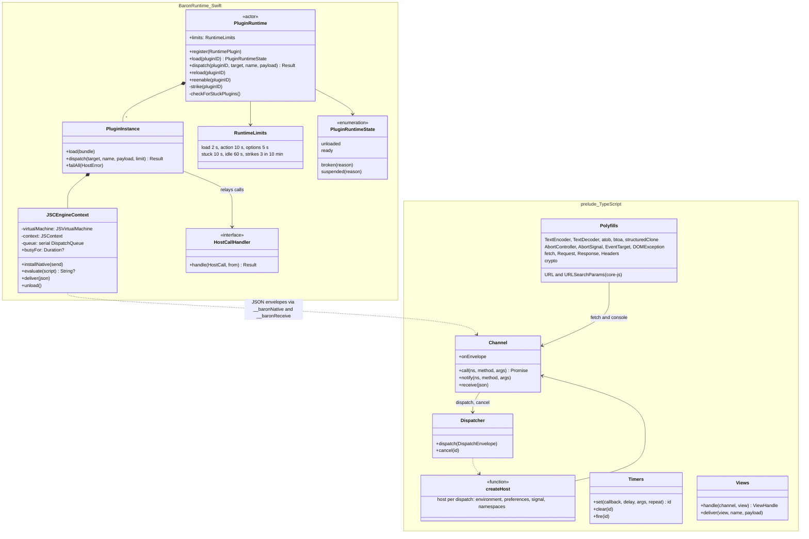

# 02 · Runtime

Part of the [Baron Plugin Platform design](README.md).

The runtime loads a plugin's code into a JavaScript context of its own, gives it the web-platform subset and the `host` object, and calls its exported functions. JavaScriptCore runs it on macOS; QuickJS-NG implements the same contract elsewhere. It is built in-process first, behind a message-based bridge, and moved into a sandboxed XPC helper (stage 2) without any change a plugin can see.

**Scope.** In: contexts, loading code, globals, promises and timers, calling plugin functions, errors, limits, unloading, the XPC stage. Out: what each host method does ([03](03-host-api-and-ipc.md)), page scripts ([07](07-web-views.md)), the React renderer ([08](08-native-views.md)).

## Contexts and threads

- **One context per plugin, in its own virtual machine.** Each plugin gets a `JSVirtualMachine` with one `JSContext`. Objects can't cross virtual machines, so plugins can't reach each other, and each has its own heap.
- **One serial queue per plugin.** All work for a plugin's context runs on its own serial dispatch queue: calls, timers and replies. Two plugins never block each other; a slow plugin never blocks Baron's main thread.
- **Nothing else in the global scope.** A fresh context has only the ECMAScript built-ins. Baron adds the prelude (below) and one native object, `__baronNative`, through which every host call travels.

## Plugin code format

Authors write ES modules in TypeScript. `baron build` bundles them into one classic script that assigns the plugin's definition to `globalThis.__baronPlugin`:

```ts
import { definePlugin } from "@baron/api";

export default definePlugin({
  actions: {
    async lookup(ctx, host) { /* … */ },
  },
  options: {
    async decks(prefs, host) { return [{ value: "Default", title: "Default" }]; },
  },
  lifecycle: {
    async onInstall(host) {},
    async onUpdate({ previousVersion }, host) {},
  },
});
```

A classic script, not an ES module, because it evaluates the same way in JavaScriptCore (`evaluateScript`) and QuickJS (`JS_Eval`) and needs no module loader. The bundle is at most 5 MB.

## The prelude: the web-platform subset

Before the plugin's bundle, every context evaluates the prelude, `@baron/runtime`, a TypeScript package compiled to one script (about 120 KB, copied into BaronRuntime's resources by `npm run build -w packages/runtime`; a test keeps the copy current). It is identical on every engine. It takes the one native object it needs and removes it from plugin reach:

| `__baronNative` | Does |
| --- | --- |
| `send(json)` | Sends one envelope to Baron |
| `setTimer(id, ms)`, `clearTimer(id)` | One-shot native timers that call `__baronFireTimer(id)` on the plugin's queue |
| `randomBytes(count)` | Cryptographic random bytes (`SecRandomCopyBytes`) |
| `digest(algorithm, base64)` | SHA digests (CryptoKit), synchronously, since they are quick and side-effect free |

Envelopes come back through `__baronReceive(json)`.

| Global | Provided by |
| --- | --- |
| `console` | Prelude, sent to `host.log` |
| `setTimeout`, `setInterval`, `clearTimeout`, `clearInterval` | Native timers on the plugin's queue |
| `queueMicrotask` | Prelude, over `Promise` |
| `fetch`, `Request`, `Response`, `Headers` | Prelude, over `host.http` ([03](03-host-api-and-ipc.md)) |
| `URL`, `URLSearchParams` | core-js's WHATWG implementation, installed on every engine (neither has them on its own) |
| `TextEncoder`, `TextDecoder` | Prelude polyfill, UTF-8 only |
| `AbortController`, `AbortSignal`, `Event`, `EventTarget`, `DOMException` | Prelude polyfills; aborting a `fetch` cancels the native request by id. Each dispatch's handler gets `host.signal`, aborted when the dispatch is cancelled |
| `atob`, `btoa`, `structuredClone` | Prelude polyfills |
| `crypto.getRandomValues`, `crypto.randomUUID` | Native (`SecRandomCopyBytes`) |
| `crypto.subtle.digest` | Native (CryptoKit): SHA-1, SHA-256, SHA-384, SHA-512 |

Not provided: DOM, `Intl` beyond what the engine has (use `host.text.segment`), Node globals (`process`, `Buffer`, `require`), `WebSocket`, `localStorage` (use `host.storage`).

## Calling into the plugin

Baron never calls plugin functions directly. It sends a dispatch envelope ([03](03-host-api-and-ipc.md)) to the prelude, which finds the export, calls it with the right arguments, awaits it, and replies with a result or a classified error.

| Dispatch | Calls | Time limit |
| --- | --- | --- |
| `action` | `actions[name](context, host)` | 10 s |
| `options` | `options[name](preferences, host)`, for settings ([06](06-settings.md)) | 5 s |
| `button` | `buttons[name](preferences, host)`, for settings buttons ([06](06-settings.md)) | 10 s |
| `lifecycle` | `onInstall`, `onUpdate` | 10 s |
| `event` | A page or native view event handler ([07](07-web-views.md), [08](08-native-views.md)) | 5 s |

Several dispatches can be in flight for one plugin; async handlers interleave on its queue as in any JavaScript event loop.

## Errors

- **Plugin errors** (an exception or rejected promise) come back with message and stack. Baron shows a toast naming the plugin and logs the details; `baron dev` prints them with source-mapped TypeScript lines.
- **Host errors** reach plugin code as `BaronError` with a `code` ([03](03-host-api-and-ipc.md)), so plugins can handle `permission_denied` or `timeout` deliberately.
- **Load errors** (the bundle throws while evaluating, or defines no actions) mark the plugin broken in Settings with the message.

## Lifecycle

1. **Unloaded** until first needed: an action click, a settings pane, an open panel.
2. **Loading:** create the context, evaluate the prelude and the bundle (limit 2 s).
3. **Ready**, serving dispatches.
4. **Idle** when no dispatch is pending and no panel or settings pane is open. After 60 s idle the context is discarded and its timers cleared. Plugins must not rely on timers outliving the work that started them.
5. **Reloaded** fresh after an update, a preference change, or a `baron dev` rebuild.

## Limits and stuck plugins

| Limit | Value | When exceeded |
| --- | --- | --- |
| Dispatch time | Per the table above | The caller gets `timeout`; the plugin is told through `AbortSignal` |
| Synchronous loop | 10 s without returning to the event loop | Stage 1: the plugin is marked unresponsive and disabled; its thread is abandoned until Baron restarts. Stage 2: the helper is restarted |
| Memory | Stage 2: helper above 512 MB | The helper is restarted |
| Strikes: dispatches that ran out of time (stage 2 adds helper crashes) | 3 in 10 minutes | The plugin is suspended with a "Re-enable" button |

As built in stage 1 (task-005): the engine records when it enters plugin code, and a watchdog running four times per stuck limit suspends a plugin stuck in one synchronous run, fails its waiting dispatches with `unavailable`, and abandons its context. The same watchdog unloads idle contexts. A load that never returns (a top-level loop) is raced against its limit rather than awaited.

JavaScriptCore can't interrupt a running loop through public API, which is the main reason for stage 2. QuickJS can, through its interrupt handler and per-runtime memory limit.

## Stage 2: the sandboxed helper

- **`BaronPluginHost.xpc`**, inside `Baron.app/Contents/XPCServices`, with App Sandbox and no network or file entitlements.
- **All plugins share one helper process**, each in its own virtual machine, which keeps memory low. A helper per plugin stays possible later for plugins that misbehave.
- **The helper reads no files.** Baron sends the prelude and each bundle's source over the connection, so the helper needs no file access at all.
- **Same envelopes, new transport.** The envelopes are unchanged; an `NSXPCConnection` carries them both ways.
- **Crash recovery.** If the helper crashes, pending calls fail with `unavailable`, Baron relaunches it on the next need, and the plugin that was running counts a strike.

## Debugging

In development mode (`baron dev`), contexts are marked inspectable, so Safari's Web Inspector can attach, set breakpoints and profile.

## Targets to measure

| Target | Measured (task-005, M1 Pro, release build) |
| --- | --- |
| Loading a 200 KB bundle: under 50 ms on an M1 | About 7 ms, prelude included |
| Dispatch overhead: under 2 ms | About 0.08 ms for a full round trip |
| An idle context: under 10 MB | About 2 MB |

`swift test -c release --filter PerformanceTests` prints them.

## Risks

- **Polyfill fidelity.** `URL` and `fetch` are polyfills; plugins may hit edge cases. Mitigation: well-known implementations, and conformance tests shared with QuickJS.
- **Stuck loops in stage 1** can't be interrupted. Mitigation: stage 2 before third-party plugins and before ODH ships.

## UML

Drawn from the code at the end of task-005 (stage 1): `packages/runtime` (the prelude) and `macos/Sources/BaronRuntime`. Stage 2 (task-011) replaces the in-process engine with the helper.



A plugin's context in stage 1:

```mermaid
stateDiagram-v2
  [*] --> Unloaded: register
  Unloaded --> Ready: first dispatch or load; prelude and bundle evaluated within 2 s, actions defined
  Unloaded --> Broken: bundle missing, throws, defines no actions, or loads past 2 s
  Ready --> Unloaded: idle 60 s with nothing in flight, or reload
  Ready --> Suspended: stuck 10 s in one synchronous run, or 3 timeouts in 10 minutes
  Suspended --> Unloaded: reenable (a fresh context)
  Broken --> [*]
```



## Gate (task-005 for stage 1, task-011 for stage 2)

- [x] A sample plugin with an uppercase action and a `fetch`-based lookup runs from Baron's bar (`examples/uppercase`, `examples/lookup`; `macos/scripts/uitest-plugins.sh`)
- [x] Its tests pass on JavaScriptCore and QuickJS-NG with the same prelude
- [x] Timers, errors, time limits, idle unload and reload are covered by tests
- [ ] Stage 2: the same plugin runs in the helper; killing the helper mid-action yields `unavailable` and the next action works
