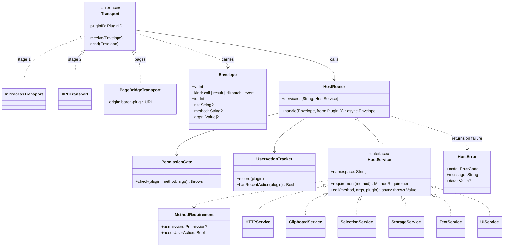
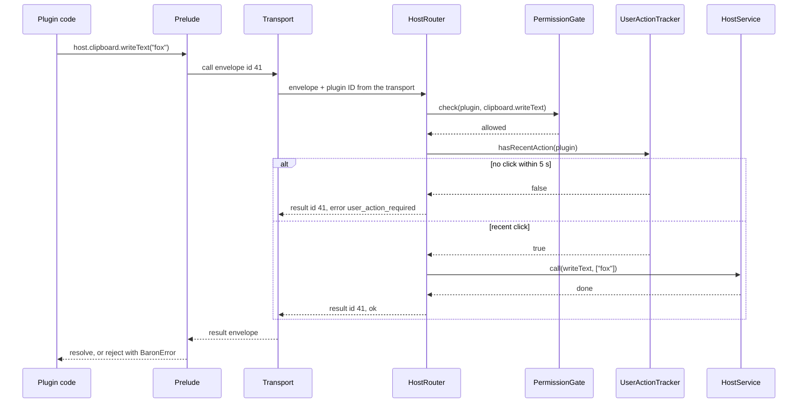

# 03 · Host API and IPC

Part of the [Baron Plugin Platform design](README.md).

`host` is the only door from plugin code to the system. Every call is a JSON message, checked against the plugin's permissions in Baron's main process, then served by a Swift service. The same messages run in-process now, over XPC in stage 2, and from plugin pages through the page bridge.

**Scope.** In: every `host` namespace and its contract, action results, the message envelope, error codes, the three transports. Out: permission rules themselves ([04](04-permissions-and-security.md)), storage internals ([05](05-storage.md)), panels ([07](07-web-views.md)).

## The `host` object (apiVersion 1)

```ts
interface Host {
  environment: {                 // read-only, synchronous
    apiVersion: 1; baronVersion: string; pluginVersion: string;
    platform: "macos" | "windows" | "linux";
    locale: string;                // BCP 47, e.g. "zh-Hans"
    appearance: "light" | "dark";
    development: boolean;          // true under `baron dev`
  };
  preferences: Readonly<Record<string, PreferenceValue>>;   // synchronous snapshot; secrets excluded

  http: { fetch(url: string, init?: HttpInit): Promise<HttpResponse> };   // also behind global fetch()
  clipboard: { readText(): Promise<string>; writeText(text: string): Promise<void> };
  selection: { replace(text: string): Promise<void> };
  storage: { get<T>(k: string): Promise<T | undefined>; set(k: string, v: unknown): Promise<void>;
             remove(k: string): Promise<void>; keys(): Promise<string[]>; usage(): Promise<number> };
  cache: { get(k: string): Promise<string | undefined>; set(k: string, v: string): Promise<void>;
           remove(k: string): Promise<void>; clear(): Promise<void> };
  secrets: { get(k: string): Promise<string | undefined>; set(k: string, v: string): Promise<void>;
             remove(k: string): Promise<void> };
  text: { segment(text: string, unit: "word" | "sentence"): Promise<Array<{ start: number; end: number }>> };
  ui: {
    toast(message: string, kind?: "info" | "success" | "error"): Promise<void>;
    openUrl(url: string): Promise<void>;
    openWebView(path: string, options?: { data?: unknown; width?: number; height?: number }): Promise<ViewHandle>;
    show(view: BaronElement): Promise<ViewHandle>;            // native views, after ODH (08)
    openSettings(): Promise<void>;
  };
  permissions: {
    query(names: string[]): Promise<Record<string, "granted" | "denied" | "prompt">>;
    request(names: string[]): Promise<string[]>;               // returns what is granted afterwards
  };
  log: { debug(...a: unknown[]): void; info(...a: unknown[]): void; warn(...a: unknown[]): void; error(...a: unknown[]): void };
}

interface ViewHandle {
  postMessage(message: unknown): Promise<void>;
  onMessage(listener: (message: unknown) => void): void;
  close(): Promise<void>;
  closed: Promise<void>;
}
```

## Namespace rules

| Namespace | Permission | Needs a user action | Notes |
| --- | --- | --- | --- |
| `environment`, `preferences`, `log` | None | No | `preferences` is refreshed before every dispatch; plugin log lines are private in the system log and shown in `baron dev` |
| `http.fetch` | `network:` entries ([04](04-permissions-and-security.md)) | No | See below |
| `clipboard.readText` | `clipboard.read` | Yes | |
| `clipboard.writeText` | None | Yes | |
| `selection.replace` | `selection.replace` | Yes | Only when the selection is editable; sets `AXSelectedText` where the app allows it, otherwise pastes with the clipboard saved and restored |
| `storage`, `cache` | None (implicit) | No | [05](05-storage.md) |
| `secrets` | `secrets` | No | [05](05-storage.md) |
| `text.segment` | None | No | `NLTokenizer` on macOS, ICU elsewhere |
| `ui.toast`, `ui.openSettings` | None | No | |
| `ui.openUrl` | None | Yes | `https`, `http` and `mailto` only; opens the default app |
| `ui.openWebView`, `ui.show` | None | Yes | Opens the result panel ([07](07-web-views.md), [08](08-native-views.md)) |
| `permissions.request` | Names must be in `optionalPermissions` | Yes | Shows a native prompt ([04](04-permissions-and-security.md)) |

**User action** means a click on the plugin's bar button, or a click or key press in one of its panels, within the last 5 s. It stops a plugin from acting on the user's behalf in the background.

## `http.fetch`

- **Request:** `GET`, `HEAD`, `POST`, `PUT`, `PATCH`, `DELETE`; headers including `User-Agent` (some dictionary sites refuse unknown agents); a body as text or bytes.
- **Allowlist:** checked on the first URL and again on every redirect (up to 5).
- **Limits:** timeout 30 s by default, 60 s at most; response bodies up to 20 MB.
- **No cookies or shared state:** each plugin has its own ephemeral session, so no plugin sees another's or Safari's cookies.
- **Response:** status, headers and body; non-2xx statuses are responses, not errors, as in browsers.

## Action results

An action may return a result for Baron to carry out, or return nothing after opening a panel itself.

```ts
type ActionResult =
  | { type: "copy"; text: string }
  | { type: "replace"; text: string }                 // needs selection.replace
  | { type: "toast"; message: string; kind?: "info" | "success" | "error" }
  | { type: "openUrl"; url: string }
  | void;
```

The action receives the `SelectionContext` defined in the [app design](../../tec-design.md#context-capture), filled according to its `needs` and the plugin's permissions.

## Messages

Every exchange is one JSON envelope. Plugins never see envelopes; the prelude and the page bridge build them.

```json
{ "v": 1, "kind": "call",     "id": 41, "ns": "http", "method": "fetch", "args": ["https://…", {}] }
{ "v": 1, "kind": "result",   "id": 41, "ok": true,  "value": { "status": 200, "headers": {}, "body": "…" } }
{ "v": 1, "kind": "result",   "id": 41, "ok": false, "error": { "code": "permission_denied", "message": "…", "data": { "permission": "network:dict.cn", "requestable": true } } }
{ "v": 1, "kind": "dispatch", "id": 7,  "target": "action", "name": "lookup", "payload": { "context": {} } }
{ "v": 1, "kind": "event",    "view": "v3", "name": "message", "payload": {} }
```

- **Directions:** `call` goes from plugin to Baron; `dispatch` and `event` go from Baron to plugin; `result` answers either, matched by `id`.
- **Identity:** the plugin's ID is never in the envelope. The transport knows which context or page sent it, so a page can't claim to be another plugin.
- **Bytes** travel as base64 strings in v1. One envelope is at most 25 MB.
- **Concurrency:** Baron serves a plugin's calls concurrently; each Swift service is an actor and keeps its own order.

## Error codes

| Code | Meaning |
| --- | --- |
| `permission_denied` | Not granted; `data.permission` names it, `data.requestable` says whether `permissions.request` can ask |
| `user_action_required` | Needs a user action within the last 5 s |
| `invalid_argument` | Wrong type or value; `data.path` points at it |
| `network_error` | DNS, TLS or connection failure; `data.reason` |
| `timeout` | The call or the dispatch ran out of time |
| `quota_exceeded` | Storage or cache full; `data.limit`, `data.used` |
| `not_found` | A missing view, file or key where that is an error |
| `unavailable` | The helper restarted (stage 2) or the panel closed |
| `internal` | A bug in Baron; reported with a log reference |

## Transports

| Transport | From | Carries | Stage |
| --- | --- | --- | --- |
| In-process | Engine context on the plugin's queue | Native function `__baronNative.send(json)` with a completion | 1 |
| XPC | Helper process | `NSXPCConnection` in both directions, `Data` holding the JSON | 2 |
| Page bridge | Plugin page in a web view | `WKScriptMessageHandlerWithReply`; identity from the page's `baron-plugin://<id>/` origin | 1 and 2 |

On the Swift side, one router maps `ns.method` to a service. It asks the permission gate ([04](04-permissions-and-security.md)) and the user-action tracker before the service runs, so no service can forget a check.

## UML

Design-level diagrams: they show the planned types, and tasks 005 and 006 replace them with diagrams of the code as built.



One host call, from plugin code to a Swift service and back:



## Gate (task-005 core, task-006 complete)

- [ ] Every namespace is implemented with unit tests at the Swift service level
- [ ] Contract tests call every method from JavaScript on both engines and check results and error codes
- [ ] A page and an engine context of the same plugin get identical answers to the same call
