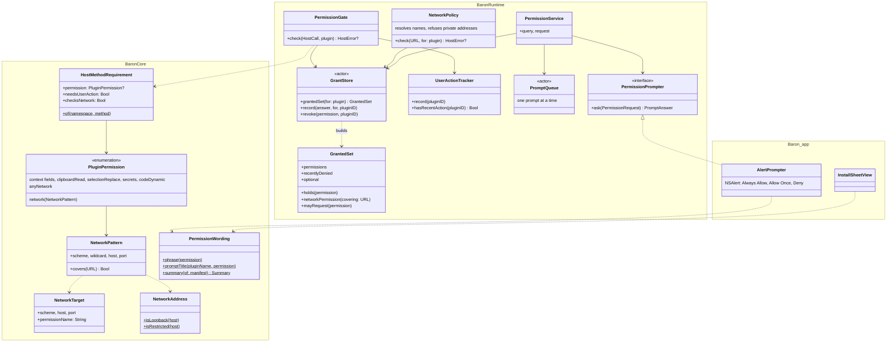
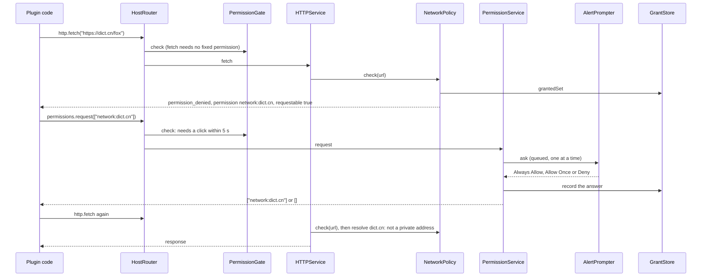
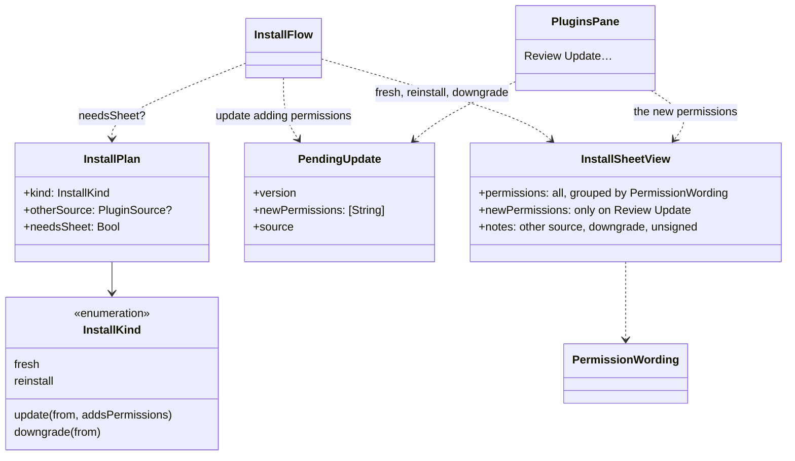

# 04 · Permissions and security

Part of the [Baron Plugin Platform design](README.md).

Baron sees everything a user selects, so a plugin gets nothing it didn't declare and the user didn't accept. Permissions are checked in Baron's main process on every host call; the plugin's context has no other way out.

**Scope.** In: the threat model, the permission catalogue, network matching, run-time requests and prompts, install consent, dynamic code, logging privacy. Out: the host methods themselves ([03](03-host-api-and-ipc.md)), Keychain details ([05](05-storage.md)).

## Threat model

| Threat | Example | Defence |
| --- | --- | --- |
| Stealing what users select | A plugin sends every selection to its server | Plugins only receive a selection when the user clicks their action (or turned on "Run on selection"); network limited to declared hosts; sentence, paragraph, page and window need permissions |
| Reading private files or other apps' secrets | A plugin reads `~/.ssh` or another plugin's API key | No file API; secrets are scoped per plugin in the Keychain |
| Acting without the user | Opening URLs or replacing text in the background | Side-effecting calls need a user action within 5 s ([03](03-host-api-and-ipc.md)) |
| Probing the local network | Calling a router admin page or a local database | Private and loopback addresses are blocked unless declared exactly |
| Changing behaviour after review | Downloading new code later | Allowed only with `code.dynamic`, disclosed at install; the code keeps the plugin's permissions |
| Fake system dialogs | A page imitating a password prompt | Panels show the plugin's name and icon in Baron's own chrome; permission prompts are native and never drawn by plugins |
| Exhausting the machine | Endless loops, huge memory | Runtime limits ([02](02-runtime.md)) |
| Escaping through an engine bug | A JavaScriptCore exploit | Stage 2 runs plugins in a sandboxed helper with no file or network access ([02](02-runtime.md)) |

## Permission catalogue

| Permission | Grants | Asked | Install sheet says |
| --- | --- | --- | --- |
| `context.sentence` | The sentence around the selection | At install | "Read the sentence around what you select" |
| `context.paragraph` | The paragraph around the selection | At install | "Read the paragraph around what you select" |
| `context.page` | Page URL and title | At install | "See the web page address" |
| `context.window` | Window title and document path | At install | "See the window title and file name" |
| `network:<pattern>` | `fetch` to matching hosts | At install, or at run time when optional | "Connect to dict.cn" |
| `network:*` | Any host, but only as an optional permission, one host at a time | At run time | "Ask to connect to other websites" |
| `clipboard.read` | Reading the clipboard | At install | "Read your clipboard" |
| `selection.replace` | Replacing the selected text | At install | "Replace the text you select" |
| `secrets` | Its own Keychain items | At install | "Store passwords and keys in your Keychain" |
| `code.dynamic` | Nothing technically; a disclosure | At install | "Run code it downloads" |

Always available, no permission: the selected text, the app's name and bundle ID, `storage`, `cache`, `environment`, `log`, toasts.

## Network patterns

| Pattern | Matches |
| --- | --- |
| `network:dict.cn` | `https://dict.cn` on port 443 only |
| `network:*.youdao.com` | Any subdomain of `youdao.com`, not `youdao.com` itself |
| `network:api.example.com:8443` | That host on that port |
| `network:http://example.com` | Plain HTTP to that host (must be written out) |
| `network:127.0.0.1:8765` | Loopback, that port only; HTTP allowed for loopback |

Private (`10.0.0.0/8`, `172.16.0.0/12`, `192.168.0.0/16`, `fc00::/7`), link-local and loopback addresses match only an exact entry, and hosts are resolved before connecting so a public name can't point at a private address (refused as `permission_denied` with `reason: private_address`; names that are themselves local, such as `localhost`, and IP literals are left to the exact entries). Redirects are checked hop by hop. `packages/api/test/network-corpus.json` holds the matching rules as cases; `@baron/api`'s matcher (tooling and tests) and Baron's Swift matcher both pass it.

## Asking at run time

1. A plugin lists what it may ask for in `optionalPermissions` (for ODH: `network:*`).
2. A `fetch` to a host outside its granted set fails with `permission_denied` and `requestable: true`.
3. The plugin calls `host.permissions.request(["network:dict.cn"])` during a user action. ODH's fetch wrapper does this automatically.
4. Baron shows a native prompt naming the plugin and the host: **Deny**, **Allow Once**, **Always Allow**.
5. "Always Allow" is saved until revoked; "Deny" is remembered for 24 hours so a plugin can't nag; "Allow Once" lasts 10 minutes and is kept in memory only, so restarting Baron asks again. Saved answers live in `PluginData/<id>/grants.json` and can be changed in the plugin's Permissions settings (task-007).

Only one prompt shows at a time, across all plugins, and never while the user isn't interacting with that plugin (`permissions.request` needs a click within 5 s). A name outside `optionalPermissions`, or `network:*` itself, is refused with `invalid_argument`: plugins ask for one host at a time.

Every call passes the permission gate before its service runs: first the method's permission (`permission_denied`, with `requestable` saying whether asking could help), then a recent click where the method needs one (`user_action_required`). `HostMethodRequirement` in BaronCore lists what each method needs.

## Install and update consent

- **Install sheet:** name, author, source (folder, file or link), version, and the permissions in plain words grouped as Reads, Connects to, Can, Stores, plus the `code.dynamic` disclosure and "Unsigned" in v1. `PermissionWording` writes the words; launching Baron with `--preview-install-sheet <folder>` shows the sheet for any plugin.
- **Updates:** an update that adds permissions waits in "Needs consent" while the installed version keeps working; the plugin's settings page offers Review Update…, whose sheet lists only the new permissions. An update with the same or fewer permissions installs silently.
- **Revoking:** the Permissions section of a plugin's settings lists run-time grants with a remove button. Install-time permissions are revoked by disabling or uninstalling the plugin.

## Dynamic code

JavaScriptCore offers no reliable way to switch off `eval` or `new Function`, so `code.dynamic` is a disclosure, not a lock. `baron build` warns if a bundle uses either without declaring it, and pages get `'unsafe-eval'` in their security policy only when it is declared ([07](07-web-views.md)). Downloaded code still runs inside the plugin's permissions.

## Privacy of logs

Baron's own logs never contain selected text (app design). Plugin log lines go to the system log marked private, so they are hidden unless a developer enables private logging, and appear in full in `baron dev`.

## Signing (after v1)

Packages will carry a developer signature so updates can be tied to the same author. Until then, the install sheet shows the source and "Unsigned", and a package with the same `id` from a different source warns before replacing.

## UML

Drawn from the code at the end of task-006: `macos/Sources/BaronCore/Plugins` (the rules), `macos/Sources/BaronRuntime/Permissions` (enforcement) and the app's prompt.

Reaching a host the plugin didn't declare, as built:

Consent at install and update, added in task-008 (`macos/Sources/Baron/InstallFlow.swift`, `PluginsPane.swift`, `BaronRuntime/Install`):

```mermaid
stateDiagram-v2
  [*] --> Sheet: fresh, reinstall or downgrade
  Sheet --> Installed: Install
  Sheet --> [*]: Cancel or close
  Installed --> Installed: update with the same or fewer permissions (silent)
  Installed --> NeedsConsent: update adds permissions; the old version keeps running
  NeedsConsent --> Installed: Review Update…, Update (acceptPending)
  NeedsConsent --> Installed: Keep the old version (declinePending deletes the new copy)
```

## Gate (task-006)

- [x] Every host method rejects calls without its permission, and those needing a user action reject without one
- [x] The network matcher passes a test corpus: subdomains, ports, schemes, IP literals, private ranges, DNS pointing at private addresses, redirects
- [x] Run-time prompts work end to end in a UI test: Deny, Allow Once, Always Allow (`macos/scripts/uitest-permissions.sh`); revoking from Settings comes with task-007
- [x] The install sheet lists permissions in plain words
- [ ] An update with new permissions waits for consent (task-008, which installs and updates plugins)
