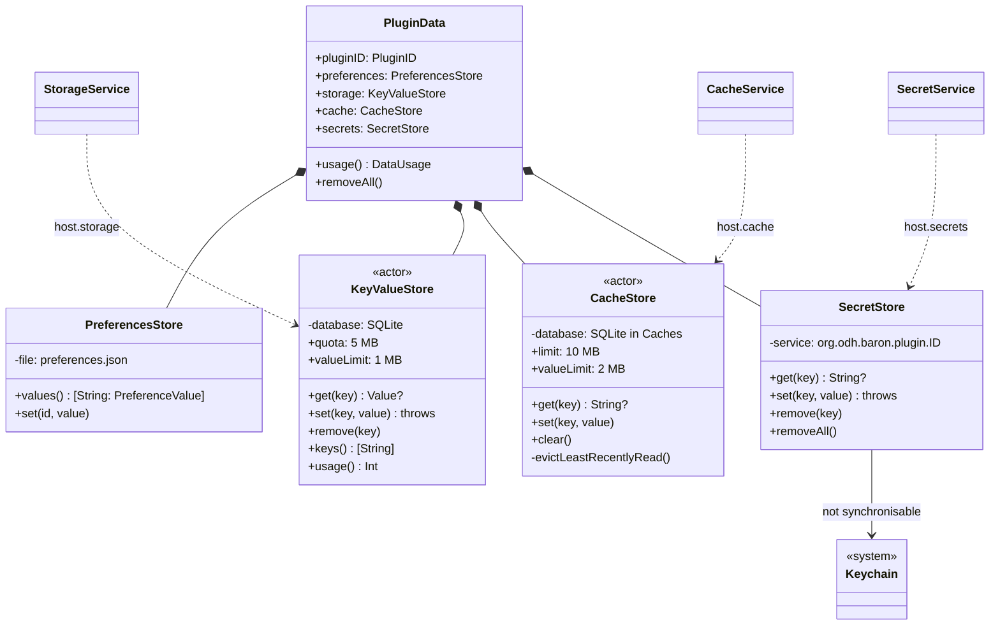
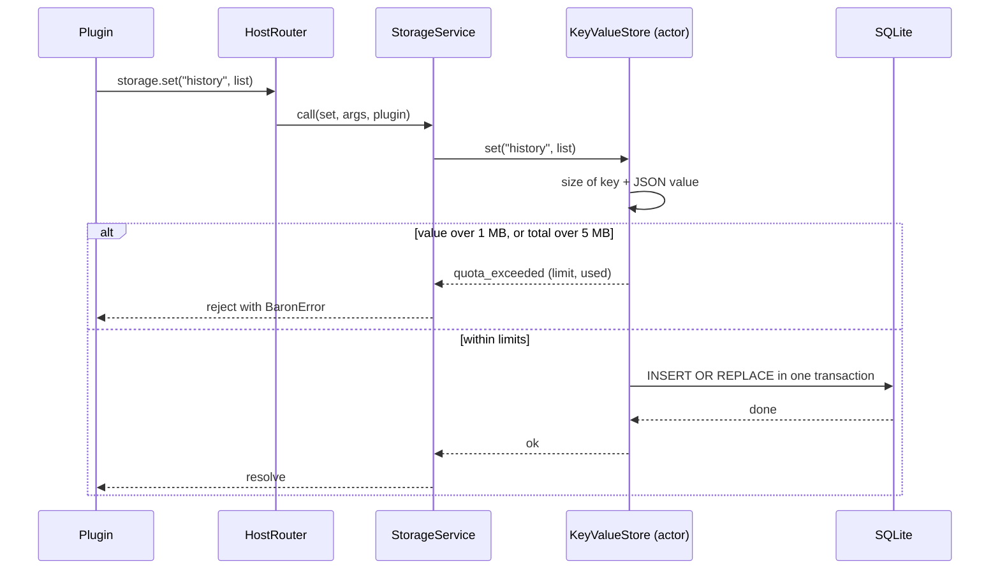

# 05 · Storage

Part of the [Baron Plugin Platform design](README.md).

Plugins keep four kinds of data, all stored by Baron: preferences (what the user set), storage (what the plugin keeps), cache (what it can lose) and secrets (what must stay private). Plugin code never touches a file.

**Scope.** In: the four stores, where they live on disk, limits, concurrency, update and uninstall. Out: the settings UI that edits preferences ([06](06-settings.md)).

## The four stores

| Store | Holds | Written by | Backed by | Limit | Survives |
| --- | --- | --- | --- | --- | --- |
| Preferences | Values of declared preferences, except secrets | The settings pane ([06](06-settings.md)); read-only to the plugin | `preferences.json` | — | Updates; removed at uninstall |
| Storage | Plugin data as JSON values | The plugin, through `host.storage` | SQLite, one table | 5 MB total, 1 MB per value | Updates; removed at uninstall |
| Cache | Disposable strings | The plugin, through `host.cache` | SQLite in the Caches folder | 10 MB total, 2 MB per value | Anything except eviction: least-recently-used entries go first, and macOS may purge it |
| Secrets | API keys, tokens, `secret` preferences | The plugin, or the settings pane for `secret` preferences | Keychain | 16 KB per value | Updates; removed at uninstall |

Keys are strings of up to 256 characters. Storage values must survive `JSON.stringify` and `JSON.parse`, so dates are stored as strings.

## On disk

```text
~/Library/Application Support/Baron/
  Plugins/<id>/<version>/          the installed package, read-only
  PluginData/<id>/
    preferences.json
    storage.sqlite
    grants.json                    run-time permission grants (04)
~/Library/Caches/Baron/PluginCache/<id>/
    cache.sqlite
Keychain: service "org.odh.baron.plugin.<id>", account = key,
          not synchronisable, accessible after first unlock
```

SQLite, the copy built into macOS, because it gives atomic per-key writes and survives crashes; a JSON file would be rewritten whole on every change. Windows and Linux hosts use SQLite too, so the stores behave the same everywhere.

## How the stores behave

- **One actor per plugin and store** serialises writes. The last write wins; v1 has no transactions.
- **Quotas** count bytes of keys plus values. A write that would exceed one fails with `quota_exceeded` and changes nothing.
- **Cache eviction** runs after each write: least-recently-read entries are removed until the cache is under 10 MB.
- **Secret preferences** are stored in the Keychain under the preference's `id` and read with `host.secrets.get(id)`; they never appear in `host.preferences`.
- **Usage** shows in the plugin's settings (Data section) with **Clear cache** and **Reset plugin data** buttons.

## Update and uninstall

- **Update:** all four stores are kept. The plugin's `onUpdate({ previousVersion })` hook can migrate its own storage.
- **Uninstall:** Baron deletes the data folder, the cache folder, every Keychain item for the plugin, and its run-time grants. Nothing is left behind.
- **Backup:** Application Support is covered by Time Machine; Keychain items follow the user's Keychain. No export in v1.

## UML

Design-level diagrams: they show the planned types, and task-007 replaces them with diagrams of the code as built.



A write that would go over the quota changes nothing:



## Gate (task-007)

- [ ] Each store has unit tests: persistence across reload, quotas, per-value limits, cache eviction order
- [ ] Uninstall removes every file and Keychain item for the plugin, checked on disk and in the Keychain
- [ ] 1,000 small writes and reads finish in under a second
