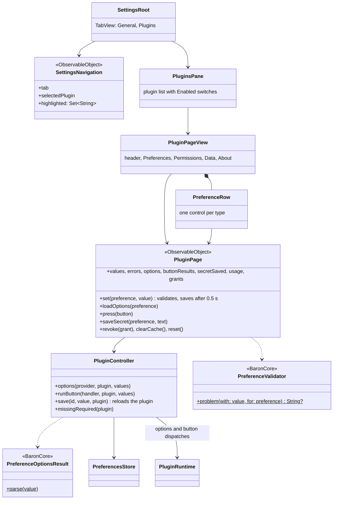
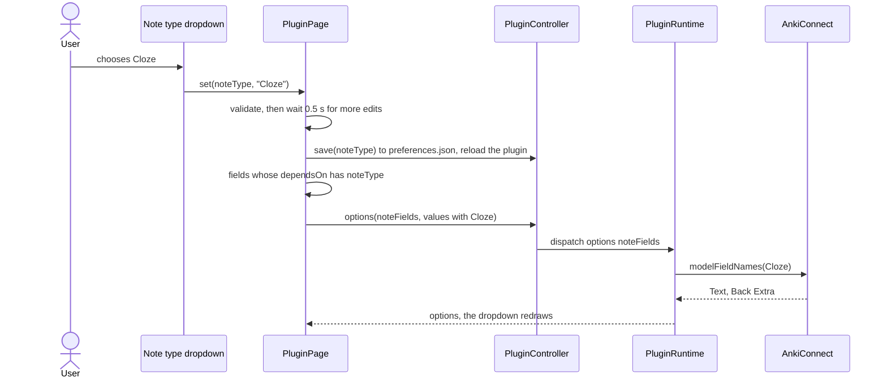

# 06 · Settings

Part of the [Baron Plugin Platform design](README.md).

Most plugins never draw settings UI: they declare preferences, and Baron draws a native pane for each plugin in its Settings window. Raycast, VS Code and PopClip work the same way. Baron adds five things they lack, so that ODH's Anki settings need no custom UI: options loaded from the plugin, checklists, editable lists, fields that depend on other fields, and buttons.

**Scope.** In: the plugin pages in Settings, every preference type, options loaded at run time, validation, saving, required-before-first-run. Out: where values are stored ([05](05-storage.md)), custom settings pages ([07](07-web-views.md), [08](08-native-views.md)).

## Where settings live

Baron's Settings window has **General** and **Plugins** tabs. Plugins lists installed plugins with an Enabled switch each (kept in Baron's settings as the plugins switched off). Selecting one shows its page:

1. **Header:** icon, name, version, author, source, Enabled.
2. **Preferences:** generated from the manifest, then the plugin's `settingsPage` if it has one.
3. **Permissions:** what was granted at install, and run-time grants with Remove buttons ([04](04-permissions-and-security.md)).
4. **Data:** storage and cache usage, Clear cache, Reset plugin data ([05](05-storage.md)).
5. **About:** description, homepage, licence; Uninstall ([10](10-install-and-lifecycle.md)).

## Preference types

Every preference has `id`, `type` and `title`, and may have `description`, `default` and `required`.

| Type | Extra fields | Control | Value |
| --- | --- | --- | --- |
| `text` | `placeholder`, `multiline`, `pattern`, `maxLength` | Text field or text area | string |
| `number` | `min`, `max`, `step` | Number field with stepper | number |
| `checkbox` | `label` | Checkbox | boolean |
| `dropdown` | `options` or `optionsFrom`, `dependsOn` | Pop-up menu | string |
| `checklist` | `options` or `optionsFrom`, `dependsOn` | List of checkboxes | string[] in option order |
| `list` | `itemPlaceholder`, `itemPattern`, `maxItems` | Editable list with add, remove and reorder | string[] |
| `secret` | `placeholder` | Secure field | Stored in the Keychain ([05](05-storage.md)) |
| `file`, `directory` | `extensions` (file only) | Path with a Choose button | string path |
| `app` | — | App picker | string bundle ID |
| `button` | `run`, `label` | Push button with a result line | none |
| `heading` | — | Section heading | none |

## Options from the plugin

A `dropdown` or `checklist` with `optionsFrom: "decks"` gets its options from the plugin's `options.decks(preferences, host)`, which returns `[{ value, title, subtitle? }]`.

1. When the pane opens, Baron calls every options provider (5 s limit each), showing a spinner in place of each control.
2. The result fills the control. On error the control shows the message and a **Retry** button.
3. A saved value missing from the new options stays selected and shows as "Deck A (not found)", so a closed Anki doesn't erase settings.
4. When a field listed in another field's `dependsOn` changes, Baron calls that field's provider again. ODH's field-mapping dropdowns depend on the chosen note type.

A `button` calls `buttons.<run>(preferences, host)` (10 s limit) and shows the returned `{ message, kind }` next to it, for example "Connected to AnkiConnect 6".

## How ODH's Anki settings look in the manifest

```json
{ "id": "anki", "type": "heading", "title": "%pref.anki%" },
{ "id": "ankiEnabled", "type": "checkbox", "title": "%pref.ankiEnabled%", "default": false },
{ "id": "ankiUrl", "type": "text", "title": "AnkiConnect URL", "default": "http://127.0.0.1:8765" },
{ "id": "testAnki", "type": "button", "title": "", "label": "%pref.testConnection%", "run": "testAnki" },
{ "id": "deck", "type": "dropdown", "title": "%pref.deck%", "optionsFrom": "decks", "dependsOn": ["ankiUrl"] },
{ "id": "noteType", "type": "dropdown", "title": "%pref.noteType%", "optionsFrom": "noteTypes", "dependsOn": ["ankiUrl"] },
{ "id": "fieldExpression", "type": "dropdown", "title": "%pref.expression%", "optionsFrom": "noteFields", "dependsOn": ["noteType"] }
```

## Validation and saving

- **Saved as you type,** as macOS settings do: each change is validated and written about half a second after the last edit; there is no Save button.
- **Invalid values** (a failed `pattern`, a number out of range, an empty required field) show an inline message and are not saved. Patterns are searched for, like `when.regex`: anchor them with `^` and `$` to match the whole value.
- **The plugin sees new values** in `host.preferences` on its next dispatch. A plugin whose context is loaded is reloaded when its preferences change.

## Required before first run

If a user clicks an action while a `required` preference is empty (for a `secret`, nothing in the Keychain), the action doesn't run. Baron opens the plugin's settings page with the missing fields highlighted and shows a toast saying the plugin needs settings.

## Custom settings

When generated fields aren't enough, a plugin adds a `settingsPage` (a web page, [07](07-web-views.md)) shown under its generated preferences. A native `settingsView` ([08](08-native-views.md)) follows after ODH. ODH needs neither.

## UML

Drawn from the code at the end of task-007: the app's `PluginsPane`, `PluginPageView`, `PreferenceControls` and `PluginSettingsModel`, over `PluginController`.



Changing ODH's note type, as built:



## Gate (task-007)

- [x] A test plugin shaped like ODH renders every preference type in Settings
- [x] Deck, note type and field dropdowns fill from a mock AnkiConnect; changing the note type refreshes the field dropdowns
- [x] List and checklist editing, a button's result line, and a secret saved in the Keychain all work in a UI test
- [x] Clicking an action with an empty required preference opens Settings with the field highlighted
