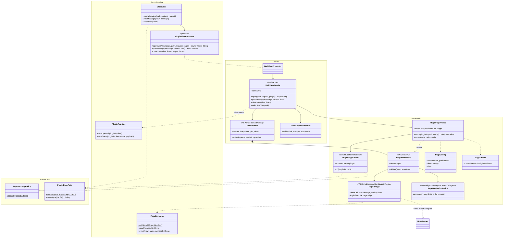

# 07 · Web views

Part of the [Baron Plugin Platform design](README.md).

A web view is a plugin's own HTML page shown by Baron, for UI that generated settings and native views can't express. ODH's dictionary popup is the first. Pages come only from the plugin's package, can't reach the network on their own, and talk to the plugin and to Baron through the same host API.

**Scope.** In: the result panel, settings pages, how pages are served, their security policy, the page bridge, images and audio, lifecycle. Out: native views ([08](08-native-views.md)), the host methods themselves ([03](03-host-api-and-ipc.md)).

## Where pages appear

| Surface | Opened by | Behaviour |
| --- | --- | --- |
| Result panel | `host.ui.openWebView(path, { data })` during a user action | A floating panel next to the selection, placed by the same rules as the action bar (above, else below, kept on screen) |
| Settings page | `settingsPage` in the manifest | Shown under the generated preferences in the plugin's settings ([06](06-settings.md)), 320 points high; its `window.baron` has no `view` |

The result panel:

- **Size:** 420 × 320 points by default; a page may ask for its content height through `baron.view.resize(height)`, up to 640 points, after which it scrolls.
- **Focus:** it takes clicks and scrolling without taking focus from the source app, so the selection stays. A click into a form field gives it keyboard focus until the panel closes.
- **Chrome:** Baron draws a thin header with the plugin's icon and name, a pin button and a close button, so users always know whose page they see.
- **Closing:** a click outside, Escape, switching apps, or a new selection closes it, unless pinned. One result panel shows at a time: opening another replaces it, pinned or not. Closing delivers `closed` to the plugin's `ViewHandle`.
- **User actions:** clicks and key presses in a page count as the user acting on its plugin, so a page's button can lead to `clipboard.writeText` or `ui.openUrl` ([04](04-permissions-and-security.md)).
- **The plugin stays loaded** while one of its views is open, so its `ViewHandle` listeners keep working past the 60 s idle unload.

## Serving pages

- **A custom scheme.** Pages load from `baron-plugin://<plugin id>/<path>`, served from the installed package by a `WKURLSchemeHandler`. Paths can't leave the package; MIME types come from the file extension.
- **One data store per plugin.** Each plugin's pages use a non-persistent `WKWebsiteDataStore`: no cookies or storage survive, and plugins can't see each other's. Persistent data goes through `baron.storage`.
- **No navigation away.** Navigating to another origin is blocked. Links open in the user's browser through `baron.ui.openUrl`, and `window.open` is refused.

## Security policy

Every page is served with this Content Security Policy:

```text
default-src 'none';
script-src 'self' [+ 'unsafe-eval' blob: only with code.dynamic];
style-src 'self' 'unsafe-inline';
img-src 'self' data: blob: <hosts from the plugin's network permissions>;
media-src 'self' blob: <hosts from the plugin's network permissions>;
font-src 'self' data:;
connect-src 'none';
frame-src 'none'; form-action 'none'; base-uri 'none';
```

Images and audio may load from hosts the plugin may already `fetch` from (its manifest's network permissions, mapped with the same scheme and port rules as `fetch`: https unless written out, plain http too for loopback), because dictionary HTML embeds pictures and pronunciation files. Scripts load only from the package, and inline event handlers never run. Data requests go through `baron.http.fetch`, so the same allowlist and prompts apply ([04](04-permissions-and-security.md)).

## The page bridge

Baron injects one script before the page's own, defining `window.baron`:

| Member | Purpose |
| --- | --- |
| `baron.http`, `baron.storage`, `baron.cache`, `baron.secrets`, `baron.text`, `baron.permissions`, `baron.ui.toast`, `baron.ui.openUrl`, `baron.environment`, `baron.preferences`, `baron.log` | The same host API as in the engine context ([03](03-host-api-and-ipc.md)), with the same permissions |
| `baron.view.data` | The `data` passed to `openWebView` |
| `baron.view.postMessage(message)`, `baron.view.onMessage(listener)` | Messages to and from the plugin's engine context, through its `ViewHandle` |
| `baron.view.resize(height)`, `baron.view.close()` | Panel control |

The bridge uses `WKScriptMessageHandlerWithReply` and the envelopes from [03](03-host-api-and-ipc.md). It is built from `packages/runtime/src/page.ts` with the same `createHost` as the prelude, so pages and engine code share one host API; `baron.view` methods travel as calls in a `view` namespace that Baron answers itself. Messages from the plugin reach the page as `event` envelopes through `__baronPageReceive`. Baron takes the plugin's identity from the page's origin (only main-frame `baron-plugin://` pages may call), never from the message. `@baron/api` types `window.baron` as `PageHost`.

## Look and feel

- **Colours:** pages get CSS variables for Baron's colours (`--baron-background`, `--baron-text`, `--baron-secondary-text`, `--baron-tertiary-text`, `--baron-accent`, `--baron-link`, `--baron-separator`, `--baron-control-background`, `--baron-selection`, `--baron-font`), taken from the system colours of both appearances, and `prefers-color-scheme` follows the system. Default page colours use `:where()`, so any rule of the page wins.
- **Language:** `baron.environment.locale` gives the user's language.
- **Audio:** plays without an extra click (`mediaTypesRequiringUserActionForPlayback` is empty), because pronunciation buttons are the point.

## Lifecycle and speed

- **One web view per open panel**, released on close.
- **Kept warm:** after closing, the web view stays alive for 30 s; the next page from the same plugin reloads in it with its new config, skipping a new web content process.
- **Target:** under 150 ms from click to first paint when warm, under 400 ms when cold. Headless, from creating the view to the page's first script: about 250 ms cold and 55 ms warm (BaronWebTests).

## Cross-platform

The page bridge and policy are the contract; WebView2 on Windows and WebKitGTK on Linux implement the same scheme, policy and `window.baron`.

## UML

Drawn from the code at the end of task-010: `macos/Sources/BaronWeb`, the app's `ResultPanel` and `WebViewPanels`, the runtime's `UIService` and `PluginRuntime`, and `packages/runtime/src/page.ts`.



Opening a page from an action and talking to it, as built:

```mermaid
sequenceDiagram
  participant Action as Plugin action (engine)
  participant UI as UIService
  participant Panels as WebViewPanels
  participant Views as PluginPageViews
  participant Server as PluginPageServer
  participant Page as views/panel.html
  participant Bridge as PageBridge
  participant Router as HostRouter
  participant RT as PluginRuntime
  Action->>UI: host.ui.openWebView("views/panel.html", {data, height})
  UI->>UI: user action within 5 s (gate); path inside the package?
  UI->>Panels: openWebView(page, path, request)
  Panels->>Views: make, or reload the warm view of this plugin
  Views->>Server: GET baron-plugin://<id>/views/panel.html
  Server-->>Views: file + Content-Security-Policy
  Panels->>Panels: ResultPanel placed like the bar
  Panels->>RT: viewOpened (keeps the plugin loaded)
  UI-->>Action: "view-1", wrapped as a ViewHandle
  Page->>Bridge: baron.http.fetch(…) as a call envelope
  Bridge->>Router: handle(call, plugin from the page origin)
  Router-->>Page: result envelope
  Page->>Bridge: baron.view.postMessage({copy})
  Bridge->>RT: viewEvent(view-1, "message")
  RT-->>Action: ViewHandle.onMessage listener
  Action->>UI: view.postMessage({copied})
  UI->>Panels: postMessage
  Panels->>Page: __baronPageReceive(event envelope)
  Note over Panels: Escape, a click outside, an app switch or a new selection (unless pinned)
  Panels->>RT: viewEvent(view-1, "closed")
  RT-->>Action: ViewHandle.closed settles
```

## Gate (task-010)

`macos/scripts/uitest-webviews.sh` checks the panel end to end and is waiting for a person to unlock the screen. Checked headless so far (BaronWebTests, a real WKWebView): the policy blocks inline scripts, an undeclared image and `fetch`; `window.baron` calls carry the plugin from the origin and go through the same router and gate; pages stay on their origin; colours follow dark mode. Messages both ways are checked in BaronRuntimeTests and with the test harness.

- [ ] A sample plugin opens a result panel next to the selection, sized to its content
- [ ] The page shows an image and plays audio from a declared host; a `fetch` or image from an undeclared host is blocked
- [ ] `baron.*` calls from the page obey the plugin's permissions; messages flow both ways between page and engine context
- [ ] Links open in the browser; the panel closes on an outside click, Escape and app switch, stays open when pinned, and follows dark mode
