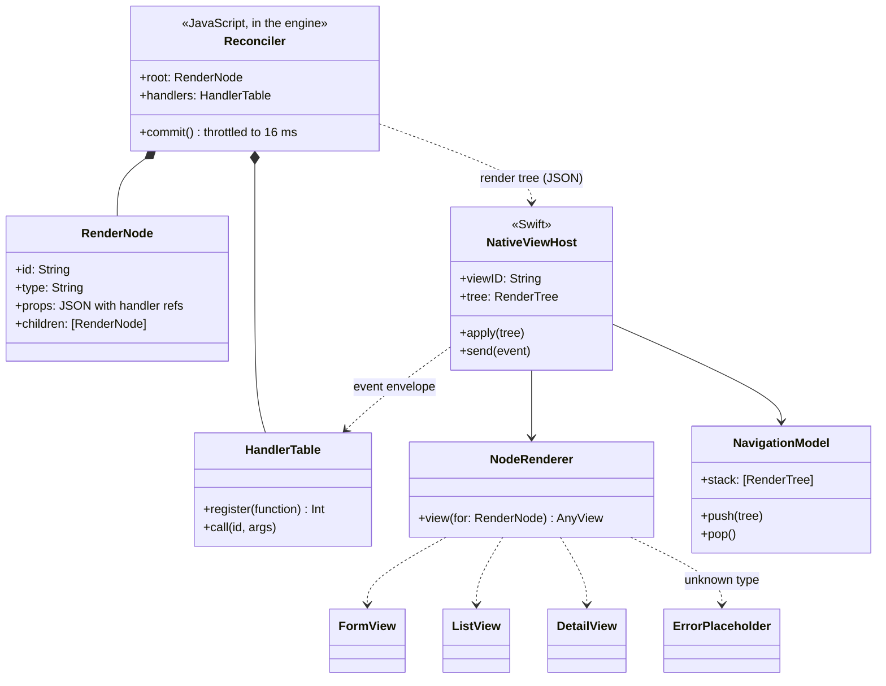
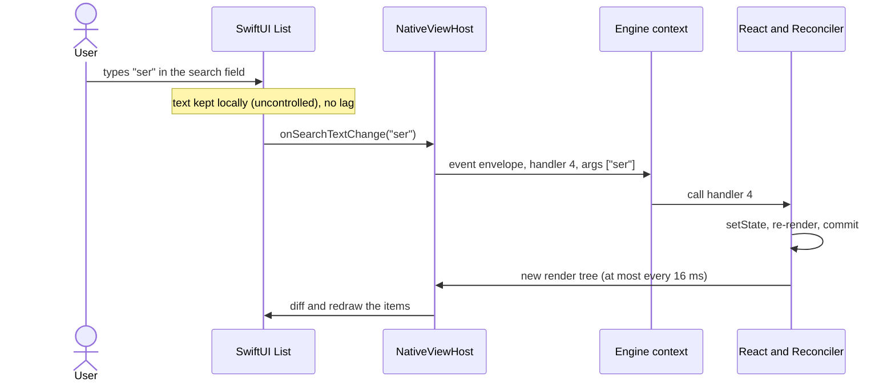

# 08 · Native views

Part of the [Baron Plugin Platform design](README.md).

Native views let a plugin build UI from React components that Baron draws with SwiftUI, so it looks and behaves like macOS and can be drawn by other hosts later. This is Raycast's model, running on Baron's sandboxed engine instead of Node. It is built after ODH (task-013): ODH doesn't need it, and the panel, bridge and events it relies on are proven by web views first.

**Scope.** In: the `@baron/ui` components, the React reconciler, the render-tree format, the SwiftUI renderer, events and navigation, where views appear. Out: the panel itself (shared with [07](07-web-views.md)), generated settings ([06](06-settings.md)).

## Components (v1)

| Component | Main props | Drawn as |
| --- | --- | --- |
| `Form` | `children`, `onSubmit` | SwiftUI `Form` |
| `Form.TextField`, `Form.TextArea` | `id`, `title`, `defaultValue`, `placeholder`, `onChange` | `TextField`, `TextEditor` |
| `Form.SecureField` | `id`, `title`, `onChange` | `SecureField` |
| `Form.Checkbox` | `id`, `label`, `defaultValue`, `onChange` | `Toggle` (checkbox style) |
| `Form.Dropdown`, `Form.Dropdown.Item` | `id`, `title`, `value`, `onChange` | `Picker` |
| `Form.NumberField` | `id`, `title`, `min`, `max`, `step`, `onChange` | `TextField` with a number format and `Stepper` |
| `Form.Description`, `Form.Separator` | `text` | Text, `Divider` |
| `List`, `List.Section`, `List.Item` | `title`, `subtitle`, `icon`, `accessories`, `actions`; `searchBarPlaceholder`, `onSearchTextChange` | `List` with a search field |
| `List.EmptyView` | `title`, `description` | Empty-state view |
| `Detail` | `markdown`, `metadata` | Scrolling Markdown text with a metadata grid |
| `ActionPanel`, `Action` | `title`, `icon`, `shortcut`, `onAction` | Toolbar buttons and a menu; the first action runs on Return |
| `Action.CopyToClipboard`, `Action.OpenInBrowser` | `content`, `url` | Built-in actions, no handler needed |

Navigation: `useNavigation()` gives `push(element)` and `pop()`, drawn as a `NavigationStack`.

## How a view is built

1. **The plugin calls `host.ui.show(<List>…</List>)`** during a user action, or names a component as its `settingsView`.
2. **React runs in the plugin's engine context.** `@baron/ui` includes React and Baron's reconciler (mutation mode), which keeps a tree of plain objects instead of DOM nodes. React needs only timers, which the prelude provides; React and the reconciler load only for plugins that import `@baron/ui`.
3. **After each React commit**, the reconciler serialises the tree and sends it to Baron, at most once per 16 ms:

```json
{ "v": 1, "view": "v3", "root": {
  "id": "n1", "type": "List", "props": { "searchBarPlaceholder": "Search words", "onSearchTextChange": { "$handler": 4 } },
  "children": [ { "id": "n2", "type": "List.Item", "props": { "title": "serendipity" }, "children": [] } ] } }
```

4. **Functions become handler IDs** (`{ "$handler": 4 }`); the reconciler keeps a table from ID to function. Props must otherwise be JSON.
5. **Baron maps each node type to a SwiftUI view.** An unknown type shows a visible error placeholder, not a crash.
6. **User input comes back as an `event` envelope** naming the handler and its arguments. The handler updates React state, React commits, and a new tree arrives.

v1 sends the whole tree on each commit. If trees grow past about 50 KB, JSON Patch diffs, as Raycast uses, replace whole trees without changing components.

## Text fields without lag

A round trip to the plugin on every keystroke would move the cursor or drop characters. Text fields are therefore uncontrolled: Baron keeps the text locally and sends `onChange` events; the plugin can reset a field only by changing its `id` or `defaultValue`.

## Where native views appear

- **The result panel** ([07](07-web-views.md)): the panel's content is a SwiftUI view instead of a web view; the header, placement and closing rules are the same.
- **Settings:** a plugin's `settingsView` is drawn under its generated preferences ([06](06-settings.md)).

## Cross-platform

The render-tree format and the component list are the contract. A Windows host maps the same tree to WinUI, Linux to GTK. Plugins never import platform UI.

## Accessibility

SwiftUI controls are accessible by default. Components take an `accessibilityLabel` where the visible text isn't enough.

## Risks

- **React's size and parse time** in every context that uses it. Mitigation: loaded only when imported; QuickJS bytecode precompiled.
- **Render-tree churn** on large lists. Mitigation: commits throttled to 16 ms; JSON Patch when needed.

## UML

Design-level diagrams: they show the planned types, and task-013 replaces them with diagrams of the code as built.



A search box in a native List, one keystroke:



## Gate (task-013)

- [ ] A sample plugin shows a Form with every field type, a searchable List with actions, and a Detail with Markdown
- [ ] Navigation push and pop work; an event round trip takes under 50 ms
- [ ] The sample's render trees are identical on JavaScriptCore and QuickJS-NG (snapshot tests)
