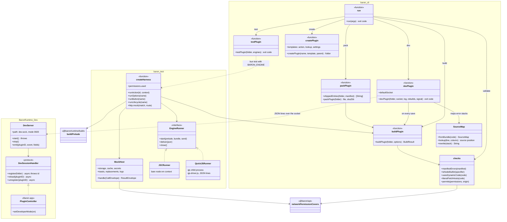
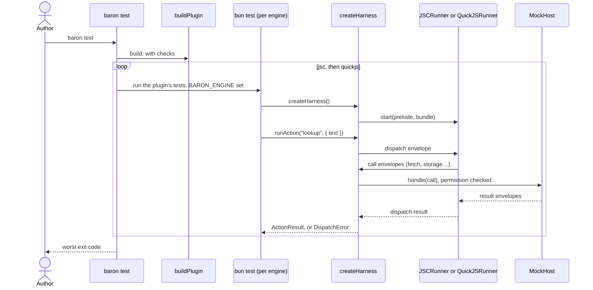

# 09 · Developer tooling

Part of the [Baron Plugin Platform design](README.md).

A plugin author needs Bun, the `baron` CLI and a few npm packages. `baron create` starts a plugin, `baron dev` runs it inside the real Baron and reloads it on save, `baron test` runs its tests on both engines, and `baron pack` makes a file to share. Bun is the toolchain because its bundler, TypeScript support, watcher and test runner are one fast install, and its engine is JavaScriptCore, the one plugins run on in macOS.

**Scope.** In: the packages, every CLI command, the test harness, development mode, templates and examples, the checks `baron build` makes. Out: the runtime itself ([02](02-runtime.md)), installing packages for users ([10](10-install-and-lifecycle.md)).

## Packages

They live in this repository under `packages/`, with the ODH plugin under `plugins/` and examples under `examples/`. All are workspaces of the root `package.json`, so one `npm install` and one lockfile serve ODH and Baron; Bun runs their tests and builds. Publishing to npm comes later.

| Package | For | Contents |
| --- | --- | --- |
| `@baron/api` | Plugin authors | Types for `Host`, `SelectionContext`, `ActionResult` and the manifest; `definePlugin`; the manifest JSON Schema |
| `@baron/runtime` | Baron only | The prelude ([02](02-runtime.md)), compiled to one script and shipped inside Baron.app; `@baron/runtime/build` builds it for the test harness |
| `@baron/ui` | Plugin authors, after ODH | Components and the reconciler ([08](08-native-views.md)) |
| `@baron/test` | Plugin authors | The test harness: a mock host, fixtures, runners for both engines |
| `@baron/cli` | Plugin authors | The `baron` command |

## Commands

| Command | Does |
| --- | --- |
| `baron create <name> [--template action\|lookup\|webview\|settings]` | Makes a folder with `manifest.json`, `src/main.ts`, a test, `tsconfig.json` and `package.json`, and for `webview` a page in `views/`. Until the packages are on npm, `package.json` links `@baron/*` to this repository with `file:` paths |
| `baron build` | Bundles `src/main.ts` into the manifest's `main` (one classic script, source map inline) through a virtual entry that assigns the default export to `globalThis.__baronPlugin`; validates the manifest; runs the checks below |
| `baron dev` | Builds on every save and loads the plugin into the running Baron in development mode, streaming its logs and errors to the terminal |
| `baron test [--engine jsc\|quickjs\|all]` | Builds, then runs the plugin's own `bun test` once per engine with `BARON_ENGINE` set; `all` (the default) runs both and returns the worst exit code |
| `baron validate` | Only checks the manifest |
| `baron pack` | Builds, validates, and zips what the package ships ([10](10-install-and-lifecycle.md#installing)) as `<id>-<version>.baronplugin`, printing its SHA-256 |

## Checks in `baron build`

- **Manifest:** schema and semantic validation ([01](01-package-and-manifest.md)), errors with JSON Pointer paths.
- **No Node built-ins:** importing `fs`, `child_process`, `net` or similar fails the build with an explanation.
- **Dynamic code:** `eval` or `new Function` without `code.dynamic` is a warning.
- **Hosts:** string-literal URLs in `fetch` calls whose host isn't in `permissions` or `optionalPermissions` are a warning.
- **Size:** a bundle over 5 MB fails.

## Testing on both engines

Tests are ordinary `bun test` files using the harness:

```ts
import { test, expect } from "bun:test";
import { createHarness } from "@baron/test";

test("looks up a word", async () => {
  const h = await createHarness({ engine: process.env.BARON_ENGINE });
  h.http.mock("https://dict.example/word/fox", { body: "<p>a small wild dog</p>" });
  const result = await h.runAction("lookup", { text: "fox", sentence: "The fox runs." });
  expect(result).toEqual({ type: "toast", message: "a small wild dog" });
  expect(h.permissions.used).toEqual(["network:dict.example"]);
});
```

- **JavaScriptCore:** the harness loads the prelude and the built bundle into a fresh `node:vm` context that exposes only the web-platform subset, so Bun's own Node globals don't leak into the test. Timers and crypto come from Bun.
- **QuickJS-NG:** the harness runs `qjs` (pinned v0.17.0, fetched into `.tools/` by `npm run tools:qjs`, or `$BARON_QJS`) with a driver script that removes `qjs`'s own globals (`std`, `os`, `print`, …), loads the same prelude and bundle, and exchanges the same envelopes ([03](03-host-api-and-ipc.md)) as JSON lines on standard input and output. It brings its own SHA digests, since `qjs` has none.
- **The mock host** implements the namespaces in memory: mocked HTTP routes, storage, cache, secrets, clipboard, selection, toasts, logs, `text.segment` and optional-permission requests. It checks network permissions with the same matcher as `baron build` (`networkPermissionCovers` in `@baron/api`), so a missing permission fails the test, and `h.permissions.used` lists what was used.
- **The harness** (`createHarness({ plugin, engine, preferences })`) builds the plugin, starts it, and offers `runAction`, `runOptions`, `runButton` and `runLifecycle`; failures reject with `DispatchError` carrying the code.

## Development mode

- **Turned on** in Baron's Settings (Advanced › Developer mode). Baron then listens on a socket in its Application Support folder that only the same user can open.
- **`baron dev`** connects and registers the plugin folder. Baron loads it from the folder, without copying, and marks it "Development" in Settings.
- **Each rebuild** that changes the bundle reloads the plugin's context; a rebuild with an identical bundle (a save without changes, or a late file event) doesn't. Open panels reload too once web views exist (task-010).
- **Logs and errors** stream to the terminal with TypeScript line numbers. Contexts are inspectable in Safari's Web Inspector.

## Templates and examples

- `action`: transforms the selection (uppercase) and returns `{ type: "replace" }`.
- `lookup`: fetches a definition and shows a toast.
- `webview`: opens `views/panel.html` in the result panel and answers its messages; `examples/panel` is the fuller example (a Youdao definition with its pronunciation).
- `settings`: every preference type, including options loaded from the plugin.

Each template is also a maintained example in `examples/`, built and tested in CI. Tests stand in for a plugin's pages through the harness: `h.views.opened` lists the pages it opened with their data and the messages it sent, `h.views.send(view, message)` sends a page's message, and `h.views.close(view)` closes one.

## UML

Drawn from the code at the end of task-008: `packages/cli`, `packages/test`, `packages/runtime/scripts` and `macos/Sources/BaronRuntime/Dev`.



`baron test`, as built:



`baron dev`, as built:

```mermaid
sequenceDiagram
  actor Author
  participant CLI as baron dev
  participant Build as buildPlugin
  participant Server as DevServer (Baron)
  participant Ctrl as PluginController
  participant RT as PluginRuntime
  Author->>CLI: npx baron dev
  CLI->>Build: build
  CLI->>Server: connect dev.sock (Developer mode on)
  CLI->>Server: {"op":"register","folder":…}
  Server->>Ctrl: register(folder)
  Ctrl->>Ctrl: PackageReader.read(folder, .development), shipped entries only
  Ctrl-->>Server: plugin id, or why it can't load
  Server-->>CLI: {"ok":true,"id":…}
  loop each save under src/
    CLI->>Build: rebuild
    alt bundle changed
      CLI->>Server: {"op":"reload","id":…}
      Server->>Ctrl: reload(pluginID)
      Ctrl->>RT: unload the context; next dispatch loads the new bundle
    end
  end
  RT-->>Server: log lines and errors (DevSink)
  Server-->>CLI: {"event":"log"…} / {"event":"error","stack":…}
  CLI-->>Author: printed, stack mapped to TypeScript lines
```

## Gate (grows with tasks 004, 005 and 008)

- [x] task-004: `@baron/api` types and the manifest schema are published in the workspace and used by Baron's validator tests
- [x] task-005: `baron build` and `baron test --engine all` work on the examples
- [ ] task-008: `baron create`, `baron dev` and `baron pack` work (CLI tests, and `macos/scripts/uitest-install.sh` packs and installs a package); a first-time author goes from `baron create` to their action on Baron's bar in under 2 minutes (`macos/scripts/uitest-author.sh`: create, install and dev load took 2.8 s; the bar step is waiting for an unlocked screen)
