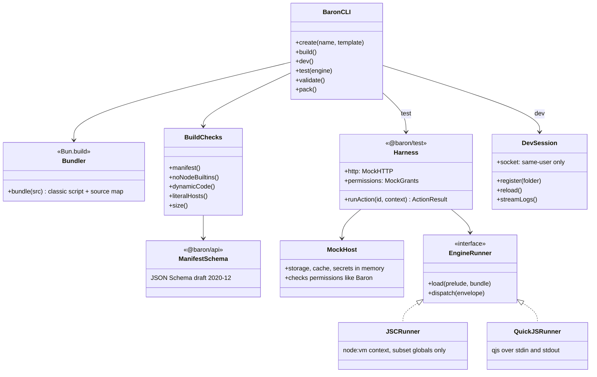
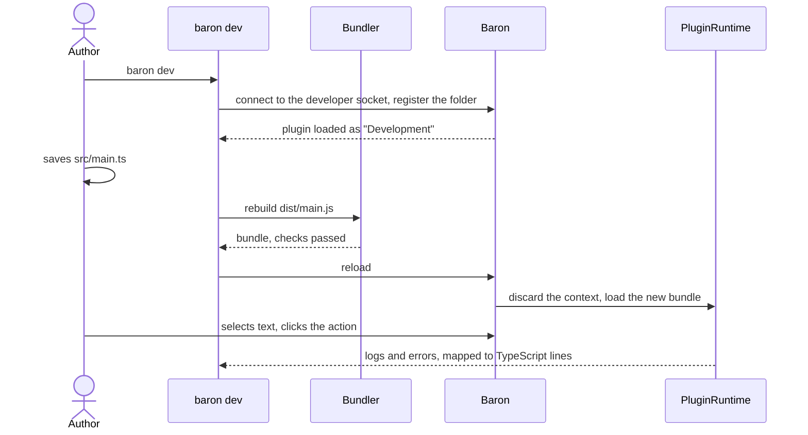

# 09 · Developer tooling

Part of the [Baron Plugin Platform design](README.md).

A plugin author needs Bun, the `baron` CLI and a few npm packages. `baron create` starts a plugin, `baron dev` runs it inside the real Baron and reloads it on save, `baron test` runs its tests on both engines, and `baron pack` makes a file to share. Bun is the toolchain because its bundler, TypeScript support, watcher and test runner are one fast install, and its engine is JavaScriptCore, the one plugins run on in macOS.

**Scope.** In: the packages, every CLI command, the test harness, development mode, templates and examples, the checks `baron build` makes. Out: the runtime itself ([02](02-runtime.md)), installing packages for users ([10](10-install-and-lifecycle.md)).

## Packages

They live in this repository under `packages/` as a Bun workspace, with examples under `examples/`; publishing to npm comes later.

| Package | For | Contents |
| --- | --- | --- |
| `@baron/api` | Plugin authors | Types for `Host`, `SelectionContext`, `ActionResult` and the manifest; `definePlugin`; the manifest JSON Schema |
| `@baron/runtime` | Baron only | The prelude ([02](02-runtime.md)), compiled to one script and shipped inside Baron.app |
| `@baron/ui` | Plugin authors, after ODH | Components and the reconciler ([08](08-native-views.md)) |
| `@baron/test` | Plugin authors | The test harness: a mock host, fixtures, runners for both engines |
| `@baron/cli` | Plugin authors | The `baron` command |

## Commands

| Command | Does |
| --- | --- |
| `baron create <name> [--template action\|lookup\|webview\|settings]` | Makes a folder with `manifest.json`, `src/main.ts`, a test, `tsconfig.json` and `package.json` |
| `baron build` | Bundles `src/` into `dist/main.js` (one classic script, source map inline), validates the manifest, runs the checks below |
| `baron dev` | Builds on every save and loads the plugin into the running Baron in development mode, streaming its logs and errors to the terminal |
| `baron test [--engine jsc\|quickjs\|all]` | Runs the plugin's tests against the built bundle; `all` (the default in CI) runs both engines |
| `baron validate` | Only checks the manifest |
| `baron pack` | Builds, validates, and zips the package as `<id>-<version>.baronplugin`, printing its SHA-256 |

## Checks in `baron build`

- **Manifest:** schema and semantic validation ([01](01-package-and-manifest.md)), errors with JSON Pointer paths.
- **No Node built-ins:** importing `fs`, `child_process`, `net` or similar fails the build with an explanation.
- **Dynamic code:** `eval` or `new Function` without `code.dynamic` is a warning.
- **Hosts:** string-literal URLs in `fetch` calls whose host isn't in `permissions` or `optionalPermissions` are a warning.
- **Size:** a bundle over 5 MB fails.

## Testing on both engines

Tests are ordinary `bun test` files using the harness:

```ts
import { test, expect } from "bun:test";
import { createHarness } from "@baron/test";

test("looks up a word", async () => {
  const h = await createHarness({ engine: process.env.BARON_ENGINE });
  h.http.mock("https://dict.example/word/fox", { body: "<p>a small wild dog</p>" });
  const result = await h.runAction("lookup", { text: "fox", sentence: "The fox runs." });
  expect(result).toEqual({ type: "toast", message: "a small wild dog" });
  expect(h.permissions.used).toEqual(["network:dict.example"]);
});
```

- **JavaScriptCore:** the harness loads the prelude and the built bundle into a fresh `node:vm` context that exposes only the web-platform subset, so Bun's own Node globals don't leak into the test.
- **QuickJS-NG:** the harness runs the same prelude and bundle in `qjs` and drives it over standard input and output with the same envelopes ([03](03-host-api-and-ipc.md)).
- **The mock host** implements every namespace in memory: HTTP routes, storage, cache, secrets, preferences, permission grants, user-action state. It checks permissions like Baron does, so a missing permission fails the test.

## Development mode

- **Turned on** in Baron's Settings (Advanced › Developer mode). Baron then listens on a socket in its Application Support folder that only the same user can open.
- **`baron dev`** connects and registers the plugin folder. Baron loads it from the folder, without copying, and marks it "Development" in Settings.
- **Each rebuild** reloads the plugin's context; open panels reload too.
- **Logs and errors** stream to the terminal with TypeScript line numbers. Contexts are inspectable in Safari's Web Inspector.

## Templates and examples

- `action`: transforms the selection (uppercase) and returns `{ type: "replace" }`.
- `lookup`: fetches a definition and shows a toast.
- `webview`: opens a result panel page.
- `settings`: every preference type, including options loaded from the plugin.

Each template is also a maintained example in `examples/`, built and tested in CI.

## UML

Design-level diagrams: they show the planned types, and tasks 004, 005 and 008 replace them with diagrams of the code as built.



`baron dev`, from a save to the new code on the bar:



## Gate (grows with tasks 004, 005 and 008)

- [ ] task-004: `@baron/api` types and the manifest schema are published in the workspace and used by Baron's validator tests
- [ ] task-005: `baron build` and `baron test --engine all` work on the examples
- [ ] task-008: `baron create`, `baron dev` and `baron pack` work; a first-time author goes from `baron create` to their action on Baron's bar in under 2 minutes
