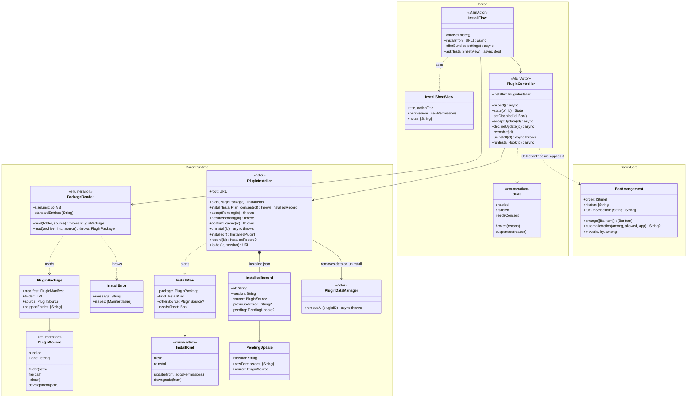
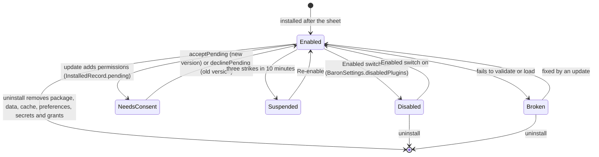

# 10 · Install and lifecycle

Part of the [Baron Plugin Platform design](README.md).

Plugins come bundled with Baron, from a folder, or from a `.baronplugin` file or link. Each moves through install, enable, update and uninstall, and the user consents at every step that changes what it can do. This sub-project also owns how plugin actions sit on the bar.

**Scope.** In: sources, states, install, update, enable and disable, uninstall, bundled plugins, broken plugins, the bar's action settings. Out: the consent rules themselves ([04](04-permissions-and-security.md)), data removal details ([05](05-storage.md)).

## Where plugins come from

| Source | How | Notes |
| --- | --- | --- |
| Bundled | Inside `Baron.app/Contents/Resources/Plugins/` (`Contents/PlugIns` is for code bundles, which code signing checks) | First-party plugins, ODH first. Offered once, at first launch, with the normal install sheet; never enabled silently |
| Folder | Settings › Plugins › Add from Folder… | What the package ships is copied into Baron's plugin folder |
| File | Opening a `.baronplugin` file | Baron registers the file type |
| Link | `baron://install?url=https://…` | HTTPS only; downloaded, then handled like a file |
| Development | `baron dev` ([09](09-developer-tooling.md)) | Loaded from the author's folder, not copied; marked "Development" |

## States

| State | Meaning | Leaves by |
| --- | --- | --- |
| Enabled | Actions appear on the bar | Disable, uninstall, a crash strike limit, an update needing consent |
| Disabled | Installed, data kept, no actions, context unloaded | Enable |
| Needs consent | An update added permissions | Accept (enabled) or keep the old version |
| Broken | Fails validation or loading, or needs a newer Baron or API | Fix by update; shown with the reason |
| Suspended | Hit the crash or stuck-loop limit ([02](02-runtime.md)) | Re-enable button |

## Installing

1. **Read the package.** Unzip into a temporary folder (files only, no symlinks, at most 50 MB unpacked), or read the folder. A package ships `manifest.json`, `dist`, `views`, `assets`, `locales`, `README.md`, `LICENSE` and the top-level folder of every path the manifest names; anything else in a source folder, such as `src` or `node_modules`, is ignored. `baron pack` zips the same list.
2. **Validate** the manifest ([01](01-package-and-manifest.md)). Refuse an unsupported `apiVersion`, a newer `minBaronVersion`, or a platform the plugin excludes, with the reason.
3. **Show the install sheet** ([04](04-permissions-and-security.md)): name, author, source, version, permissions in plain words, disclosures. If the same `id` exists from another source, say so.
4. **Copy** what the package ships to `Plugins/<id>/<version>/`, and record it in `Plugins/installed.json`. Installed versions are never modified.
5. **Run `onInstall`**, if exported, with a 10 s limit. A failure is shown but doesn't undo the install.
6. **Enable** the plugin and show its actions on the bar, after Baron's built-in ones.

## Updating

- **v1 updates are manual:** installing a higher `version` of the same `id` from any source is an update. A lower or equal version asks before replacing.
- **Same or fewer permissions:** installs silently.
- **New permissions:** the new version is copied but waits in "Needs consent" while the old one keeps working. Settings opens on the plugin, whose page offers Review Update…; the sheet lists only the new permissions. Declining deletes the waiting copy.
- **Data is kept** ([05](05-storage.md)). `onUpdate({ previousVersion })` runs once, before the first dispatch of the new version.
- **The previous version's folder** is deleted after the first successful load of the new one, which leaves a way back if the new version is broken.

## Uninstalling

Settings › Plugins › (plugin) › Uninstall, after a confirmation naming what will be deleted: the package, preferences, storage, cache, secrets and grants ([05](05-storage.md)). There is no uninstall hook: the plugin's data is removed whatever its code does.

## Actions on the bar

Settings › Bar lists every action, built-in and from plugins:

- **Order:** drag to reorder, or use the up and down buttons. New actions go at the end.
- **Show or hide** any action without disabling its plugin.
- **Run on selection:** for actions whose manifest says `"autoRun": "allowed"`, the user can choose to run them straight after a selection instead of showing a button. Off by default; it can be limited to certain apps. ODH's lookup uses this to open its popup on double-click, as the Chrome extension does.
- **Hotkey:** any action can get its own shortcut, which runs it on the current selection. Shortcuts are stored by the KeyboardShortcuts package as `action.<id>`, not in the arrangement.

## UML

Drawn from the code at the end of task-008: `macos/Sources/BaronRuntime/Install`, `macos/Sources/Baron` (InstallFlow, PluginController, the Plugins and Bar panes) and `macos/Sources/BaronCore/Bar`.



Installing from a file, a link or the bundle, as built. An update that adds permissions skips the sheet and waits for consent:

```mermaid
sequenceDiagram
  actor User
  participant Flow as InstallFlow
  participant Reader as PackageReader
  participant Installer as PluginInstaller
  participant Controller as PluginController
  participant Sheet as InstallSheetView
  User->>Flow: open .baronplugin, baron:// link or first launch
  Flow->>Reader: read(archive or folder, source)
  alt refused (bad zip, symlink, path outside, too large, invalid manifest, newer API)
    Reader-->>Flow: InstallError
    Flow-->>User: alert with the reason
  else read
    Reader-->>Flow: PluginPackage
    Flow->>Installer: plan(package)
    Installer-->>Flow: InstallPlan
    alt update with the same or fewer permissions
      Flow->>Installer: install(plan, consented: false)
      Flow->>Controller: reload()
    else update adding permissions
      Flow->>Installer: install(plan, consented: false)
      Note over Installer: record.pending set; the old version stays installed
      Flow->>Controller: reload(), then open its settings page
      User->>Controller: Review Update…, then Update
      Controller->>Installer: acceptPending(id)
    else fresh, reinstall or downgrade
      Flow->>Sheet: ask(permissions, source, notes)
      User->>Sheet: Install
      Flow->>Installer: install(plan, consented: true)
      Flow->>Controller: reload(), runInstallHook(id)
    end
  end
```

The states an installed plugin moves through, as `PluginController.state(of:)` reports them:



## Gate (task-008)

Checked by `macos/scripts/uitest-install.sh` (baron-uitest `--install`, 11 checks) and the BaronRuntime tests.

- [x] Install from a folder and from a `.baronplugin` file, including refused cases: bad zip, symlink, invalid manifest, newer API
- [x] The install sheet shows permissions; an update that adds a permission waits for consent while the old version keeps working
- [x] Disable and enable work; uninstall removes everything (checked on disk and in the Keychain)
- [x] A bundled sample plugin is offered at first launch
- [x] Bar settings: reorder, hide, Run on selection and a per-action hotkey work in a UI test
