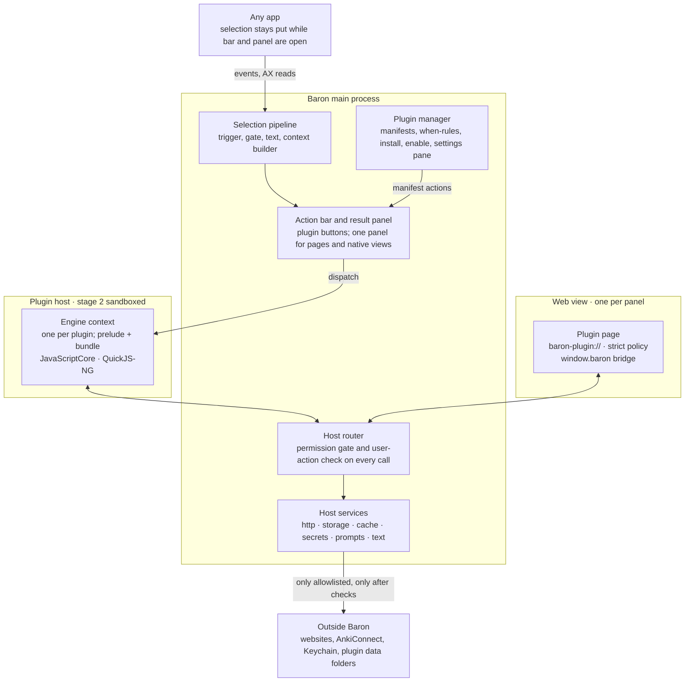
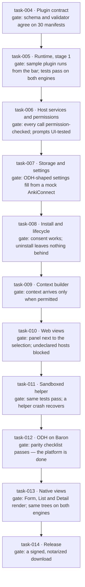

# Baron Plugin Platform — Design

2026-10-10 · mx_in · Mirror of the [Claude Docs version](https://claude.ai/code/artifact/c7b7a984-f745-4ca3-b858-81419c79e35e)

Baron's plugin platform lets third-party TypeScript plugins act on selected text, keep settings and data, and show UI, all inside a sandbox. It is split into ten sub-projects, each designed in its own file and built as its own task. The platform is done when ODH, today a Chrome extension, runs as a Baron plugin with the same features: [ODH on Baron (success test)](odh-on-baron.md).

## At a glance

Plugin code runs in its own context and reaches the network, data and screen only through the host router, both while it runs inside Baron (stage 1) and once it runs in the sandboxed helper (stage 2).

## Sub-projects

The platform has ten parts plus the context builder from the app design. Each part has one job, its own file, and its own task with a gate; ODH is the last task and the test of all of them.

| Sub-project | Owns | Needs | Built in |
| --- | --- | --- | --- |
| [01 Plugin package & manifest](01-package-and-manifest.md) | Package layout, the manifest and its schema, `when` rules, localisation | — | task-004 |
| [02 Runtime](02-runtime.md) | Engine contexts, loading plugin code, the web-platform subset, limits, the move to a sandboxed helper | 01 | task-005; helper in task-011 |
| [03 Host API & IPC](03-host-api-and-ipc.md) | The `host` namespaces, the JavaScript-to-Swift bridge, the message protocol, action results | 02 | task-005, task-006 |
| [04 Permissions & security](04-permissions-and-security.md) | Declared and run-time permissions, prompts, network rules, the threat model | 03 | task-006 |
| [05 Storage](05-storage.md) | Preferences, key-value storage, cache, secrets | 03, 04 | task-007 |
| [06 Settings](06-settings.md) | The generated settings pane, options loaded from the plugin | 01, 05 | task-007 |
| [10 Install & lifecycle](10-install-and-lifecycle.md) | Install, update, enable, uninstall, bundled plugins, the bar's action order | 01, 04, 05 | task-008 |
| Context builder ([app design](../../tec-design.md#context-capture)) | Sentence, paragraph, page and window for each action, filtered by permission | 04 | task-009 |
| [07 Web views](07-web-views.md) | The result panel, plugin pages, page security, the page bridge | 03, 04 | task-010 |
| [09 Developer tooling](09-developer-tooling.md) | `@baron/api`, the `baron` CLI on Bun, the mock host, tests on both engines | 01–03 | Grows with tasks 004–010 |
| [08 Native views](08-native-views.md) | `@baron/ui` components, the React renderer, the SwiftUI renderer | 02, 03, 07 | task-013, after ODH |
| [ODH on Baron](odh-on-baron.md) | The rewrite and its parity checklist | Everything except 08 | task-012 |

Native views come after ODH on purpose: ODH's popup is HTML produced by its dictionary scripts, and its settings fit the generated pane, so nothing on the path to the success test waits for them.

## Decisions

These answer the open questions from the [runtime research](../../research/plugin-runtime.md). Each can be revisited, but the sub-project designs assume them.

| Question | Decision | Why |
| --- | --- | --- |
| Which engine runs plugins? | JavaScriptCore on macOS; QuickJS-NG on Windows and Linux | No runtime to ship on macOS, 1.3 MB elsewhere, and a sandbox per plugin context |
| Node built-ins in plugins? | No. Plugins get a fixed web-platform subset; pure-JavaScript npm packages still bundle | Node APIs can't be sandboxed per plugin; this is what cost Raycast its sandbox |
| Role of Bun? | The developer toolchain: build, dev, test. An opt-in "full access" Bun runtime is considered after v1 | Bun has no permission model or embedding API, but its bundler and test runner fit authors well |
| In-process or separate process? | Both, in stages: in-process first behind a message-based bridge, then a sandboxed XPC helper before ODH ships | The bridge is the same in both stages, so the API settles early and the move is mechanical |
| When do native React views come? | After ODH (task-013) | ODH needs generated settings and web views only; native views shouldn't block the success test |
| Settings beyond static fields? | Generated settings gain options loaded from the plugin, editable lists, checklists, dependent fields and buttons | ODH's Anki deck, note type and field mapping then need no custom UI |
| Storage and cache limits? | 5 MB storage and 10 MB cache per plugin, single value up to 1 MB and 2 MB | Ample for settings, scripts and caches; raised per plugin later if a real plugin needs it |
| Where do secrets live? | Keychain, this Mac only (not synced through iCloud) | Safer default; syncing can be an opt-in per secret later, as PopClip does |
| Websites a plugin didn't declare? | Only through `optionalPermissions`: the first request to a new host shows a native prompt (Deny, Allow once, Always allow), remembered and revocable | ODH users add dictionary scripts from any website |
| Plugins that run downloaded code? | Allowed, declared as `code.dynamic` and shown at install. The code keeps the plugin's permissions | ODH runs user dictionary scripts; JavaScriptCore can't block `eval` reliably, so this is disclosure plus review, not enforcement |
| What may plugins do without a click? | Copying, replacing the selection, opening URLs and opening panels need a user action within the last 5 s | A plugin can't act on the user's behalf in the background |
| Where do results appear? | One result panel next to the selection, shared by web pages and native views | One place to look; the same placement rules as the action bar |
| Can an action run without the bar? | Yes, if the user switches it to "Run on selection" in Settings | ODH's popup opens straight after a double-click today |

## Build order

Each task builds on the ones above it and ends at its gate. task-003, the research and this design, closes when the user approves this design.

## Not in v1

- **Node APIs and a full-access runtime.** Considered after v1, as an opt-in Bun runtime with a clear warning.
- **A plugin store, signed packages, automatic updates.** v1 installs from a folder, a `.baronplugin` file or a link; updates are installed the same way.
- **Plugins in other languages** (WebAssembly). The contract leaves room for it.
- **Background work.** Plugins run only while answering an action, a settings pane or an open panel; there are no timers that outlive them.
- **Plugin-to-plugin calls, menu-bar items, command palettes.** Plugins add actions to the bar only.
- **ODH's "hover with a modifier key" lookup.** Baron reads selections, not the word under the pointer.
- **Windows and Linux hosts.** Every contract here is written so they can implement it later.

## Related docs and sources

- [Baron: Selection Popup App — Technical Design](../../tec-design.md) ([Claude Docs](https://claude.ai/code/artifact/a302bd64-f80d-4be1-875e-414221f4b8d6)), [runtime research](../../research/plugin-runtime.md), [Accessibility coverage](../../research/ax-coverage.md), [task backlog](../../tasks.md)
- [How the Raycast API and extensions work](https://www.raycast.com/blog/how-raycast-api-extensions-work), [Raycast preferences](https://developers.raycast.com/api-reference/preferences), [Raycast storage](https://developers.raycast.com/api-reference/storage)
- [PopClip JavaScript environment](https://www.popclip.app/dev/js-environment), [VS Code contribution points](https://code.visualstudio.com/api/references/contribution-points), [Figma plugin security](https://www.figma.com/blog/an-update-on-plugin-security/)
- [QuickJS-NG](https://github.com/quickjs-ng/quickjs), [Bun](https://github.com/oven-sh/bun), [Bun permissions request](https://github.com/oven-sh/bun/issues/25929), [react-reconciler](https://github.com/react/react/tree/fef40c061ec7db03b6b0faa7608788d625cf78db/packages/react-reconciler)
