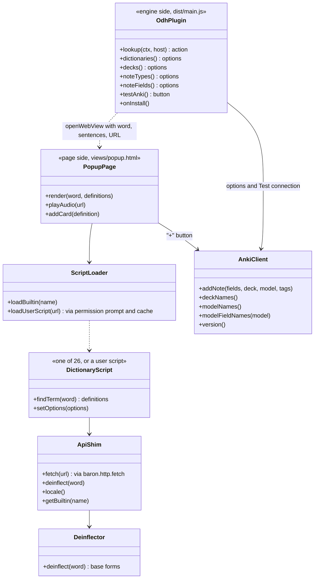
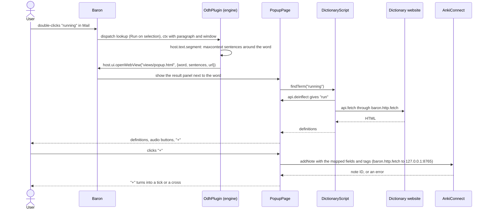

# ODH on Baron: the success test

Part of the [Baron Plugin Platform design](README.md).

The platform is done when ODH runs as a Baron plugin and a user can do everything they do with the Chrome extension today, in any app instead of only in Chrome. This file maps each ODH feature to the Baron part that carries it, and ends with the parity checklist that closes the platform (task-012).

## Shape of the ODH plugin

| Part | Runs in | Contains |
| --- | --- | --- |
| Engine side, `dist/main.js` | The plugin's engine context ([02](02-runtime.md)) | The "Look up" action, options providers (decks, note types, note fields, dictionaries), the "Test connection" button, `onInstall` |
| Page side, `views/popup.html` | The result panel ([07](07-web-views.md)) | ODH's popup UI, its 26 dictionary scripts, the deinflector and its data, a small `api` shim onto `window.baron` |
| Manifest and locales | Read by Baron ([01](01-package-and-manifest.md)) | Actions, permissions, every ODH option as a preference ([06](06-settings.md)), English and Chinese strings |

The dictionary scripts run in the page, not the engine, because they parse HTML with `DOMParser` and `innerText`, which only a real web view provides exactly. The plugin lives in `plugins/odh/` in this repository; its build copies the scripts, popup UI and deinflector from `src/`, so the Chrome extension and the Baron plugin share one copy.

## Feature map

| ODH feature | In the Chrome extension | On Baron | Parts | Plan |
| --- | --- | --- | --- | --- |
| Look up a selected word | Content script on web pages | Any app: "Look up" on the bar, or straight away with Run on selection | App pipeline, 10 | Rewrite |
| Popup with definitions | iframe injected into the page | Result panel next to the selection | 07 | Reuse the popup UI |
| 26 dictionary scripts | Sandboxed page running script text | Loaded from the package into the panel page | 07 | Reuse unchanged |
| `api.fetch` for scripts | Service worker `fetch` | `baron.http.fetch`; built-in dictionaries' hosts declared, others prompted | 03, 04 | Shim |
| Deinflection | `deinflector.js` and data | Same files in the page | 07 | Reuse |
| Built-in Collins dictionary | Private data file | Same file, bundled when present (it isn't in this repository) | 07 | Reuse |
| User scripts from URLs | Script URLs, run in the sandbox | `list` preference; fetched after a host prompt, kept in `baron.cache`, run in the page | 04–07 | Rewrite the loader |
| Choose the dictionary | Select in options and popup | Dropdown filled by the plugin | 06 | Manifest |
| Mono/bilingual, max examples, preferred audio | Selects | Preferences passed to the scripts' `setOptions` | 06 | Reuse |
| Context sentences | Cut from the page's DOM (`maxcontext`) | `ctx.paragraph`, split with `host.text.segment` | Context builder, 03 | Small rewrite |
| Page URL on the card | `window.location` | `ctx.page.url`, else the window's document | Context builder | Small rewrite |
| Pronunciation audio | Offscreen document | `<audio>` in the page | 07 | Small rewrite |
| Add a card per definition | Service worker → AnkiConnect | Page → `baron.http.fetch` to `127.0.0.1:8765` | 03 | Reuse logic |
| Deck, note type, field mapping, tags, duplicates | Options page filled from AnkiConnect | Generated settings with options from the plugin | 06 | Manifest |
| AnkiConnect status and Connect | Button and status line | "Test connection" button | 06 | Manifest |
| Spelling and translation toggles | Popup UI | Same UI | 07 | Reuse |
| Enable and Alt+Q | Badge and keyboard command | Plugin switch; per-action hotkey | 10 | Platform |
| English and Chinese UI | `_locales` and `chrome.i18n` | `locales/*.json` and `environment.locale` | 01 | Convert files |
| Quick settings in the toolbar popup | Extension popup | Baron's settings page | 06 | Partial |
| PDFs in Chrome's viewer | Special DOM handling | Any PDF app's selection; Preview has no sentence yet | Context builder | Partial |
| Hover with a modifier key | Content script | Not on Baron | — | Dropped |
| Guide and update pages | Opened as tabs | A link in the plugin's About section | 06 | Dropped |

## ODH's options as preferences

| ODH option | Baron preference |
| --- | --- |
| `enabled` | The plugin's Enabled switch |
| `mouseselection` | Run on selection for "Look up" (Settings › Bar) |
| `hotkey` (hover) | Dropped |
| `dictSelected` | `dropdown`, options from the plugin, refreshed when the script lists change |
| `monolingual`, `preferredaudio` | `dropdown` |
| `maxcontext`, `maxexample` | `number` |
| `services` | `checkbox` "Add cards to Anki" |
| `ankiconnecturl` | `text`, plus a "Test connection" `button` |
| `deckname`, `typename` | `dropdown`, options from AnkiConnect |
| `expression`, `reading`, `extrainfo`, `definition`, `definitions`, `sentence`, `url`, `audio` | `dropdown` each, options from the chosen note type's fields |
| `tags` | `text` |
| `duplicate` | `checkbox` "Allow duplicate cards" |
| `sysscripts` with on/off | `checklist` of the built-in dictionaries |
| `udfscripts` | `list` of HTTPS URLs |

ODH's permissions: `context.sentence`, `context.paragraph`, `context.page`, `context.window` (for the URL fallback outside browsers), `network:` for each built-in dictionary's site, `network:127.0.0.1:8765` for AnkiConnect, optional `network:*` for user scripts, and `code.dynamic`.

## A lookup, step by step

1. The user selects a word in any app. Baron shows "Look up" on the bar, or runs it at once if Run on selection is on.
2. The action reads the word, takes `maxcontext` sentences around it from `ctx.paragraph` (or `ctx.sentence`), takes the URL from `ctx.page` or the window's document, and opens `views/popup.html` with them.
3. The page loads the chosen dictionary script (from the package, or a user script from the cache), the deinflector and the `api` shim.
4. The script's `findTerm` fetches through `baron.http.fetch`; the popup UI renders the definitions and sizes the panel.
5. A play button plays audio in the page. A "+" button builds the card's fields from the mapping and calls AnkiConnect; the icon shows success or failure.

## UML

Design-level diagrams: they show the planned parts, and task-012 replaces them with diagrams of the code as built.

A lookup in any app, then adding a card:

## Parity checklist (gate for task-012)

- [ ] With Run on selection on, double-clicking a word in Safari, Chrome, Mail, Notes, Pages and TextEdit shows ODH's definitions next to it within 1 s, warm
- [ ] Every built-in dictionary that works in the Chrome extension gives the same definitions for the same 20 test words
- [ ] Changing the dictionary in settings changes the results
- [ ] A user script added by URL works after the user allows its host, and keeps working from the cache
- [ ] Inflected words find their base forms as in the extension
- [ ] Pronunciation audio plays
- [ ] "+" adds a card with expression, reading, definition, sentence (the word in bold), URL and audio in the mapped fields, with tags; duplicates follow the setting; the button shows the outcome
- [ ] Deck, note type and field lists load from AnkiConnect; Test connection reports the version or the error
- [ ] Monolingual, max examples, preferred audio and context sentence count behave as in the extension
- [ ] Settings and popup follow the system language: English, Simplified Chinese, Traditional Chinese
- [ ] The plugin uses nothing beyond its manifest and run-time grants, checked from Baron's permission log during the UI test run
- [ ] Engine-side tests pass on JavaScriptCore and QuickJS-NG; the lookup and add-card flow have UI tests in `baron-uitest`
- [ ] The Chrome extension still builds from the same dictionary and popup sources
