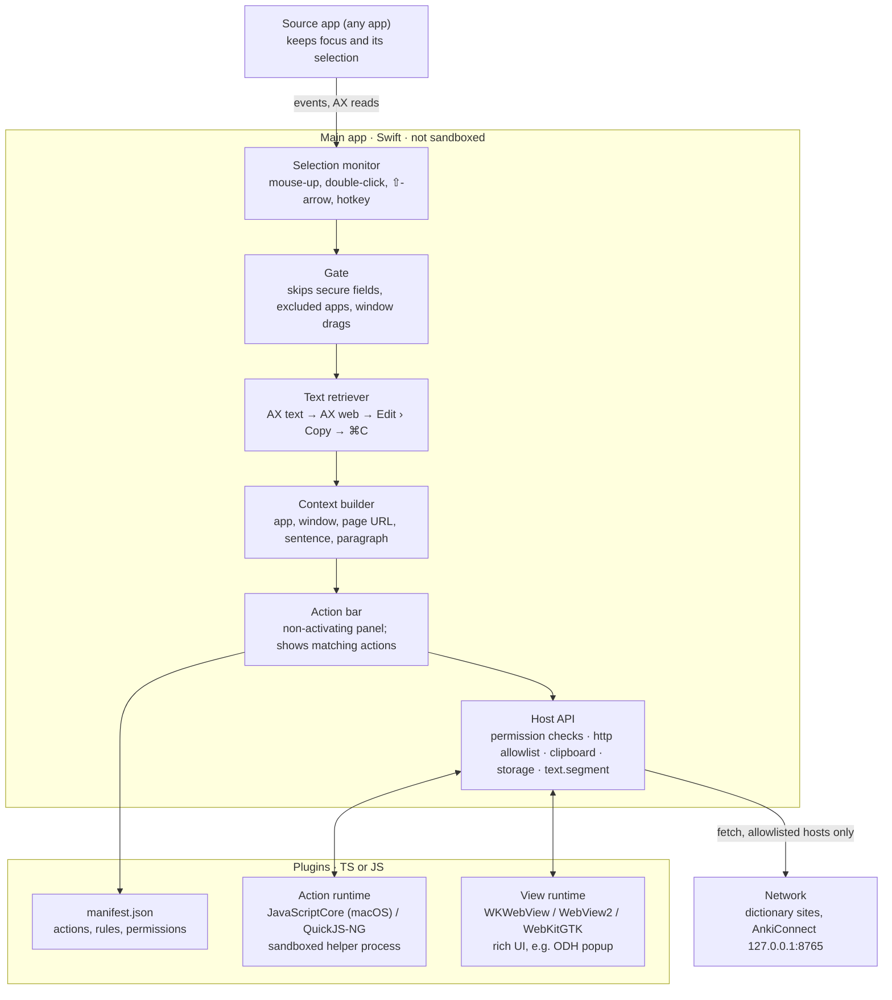
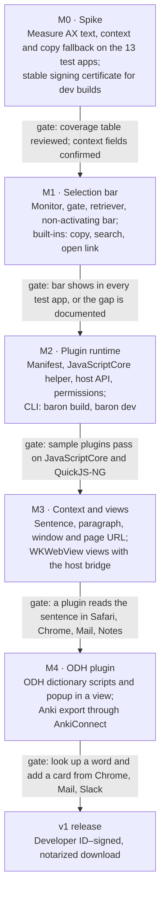

# Baron: Selection Popup App — Technical Design

2026-10-09 · mx_in · Mirror of the [Claude Docs version](https://claude.ai/code/artifact/a302bd64-f80d-4be1-875e-414221f4b8d6)

Baron is a standalone macOS app, written in Swift. It shows a small action bar whenever text is selected in any app. Every action beyond the built-ins is a plugin written in TypeScript or JavaScript, so the same plugins can run on a later Windows or Linux host. ODH dictionary lookup with Anki export is the first plugin, not part of the core app.

## Research: what can be captured

Yes: the app, window, page URL, sentence and paragraph can all be read wherever the app supports macOS Accessibility. PopClip itself only gives plugins the text, app and browser URL/title. It has no sentence or paragraph field ([popclip.d.ts](https://www.popclip.app/dev/popclip.d.ts), `interface Context`). We can do better because the needed macOS APIs are public.

| Field | How macOS gives it | Where it works | PopClip exposes it |
| --- | --- | --- | --- |
| Selected text | `AXSelectedText` on the focused element; else Edit › Copy; else simulated ⌘C | Every app (the copy steps cover the rest) | Yes |
| Rich text (HTML, RTF) | Pasteboard flavours after a copy; `AXAttributedStringForRange` | Apps that put HTML or RTF on the clipboard | Yes, opt-in |
| App name, bundle ID, PID | `NSWorkspace.frontmostApplication` | Every app | Yes |
| Window title, document file | `AXTitle`, `AXDocument` on the focused window | Most document-based apps | No |
| Page URL and title | `AXURL` on the page's `AXWebArea`; AppleScript as fallback | Chrome, Edge, Arc, Brave, Safari | Yes |
| Sentence | Web pages: `AXSentenceTextMarkerRangeForTextMarker`. Native text: read about 2,000 characters around `AXSelectedTextRange` with `AXStringForRange`, then split with `NLTokenizer(unit: .sentence)` | Browsers, WebKit views, Cocoa text views | No |
| Paragraph | Web pages: `AXParagraphTextMarkerRangeForTextMarker`. Native text: same window, expanded to the nearest line breaks | Same as sentence | No |
| Selection position on screen | `AXBoundsForRange` or `AXBoundsForTextMarkerRange`; else the mouse position | Accessibility-enabled apps | Internal only |
| Editable or not | Role (`AXTextArea`, `AXTextField`) and whether `AXSelectedText` is settable | Accessibility-enabled apps | Partly (`canPaste`, `canCut`) |

What the evidence shows:

- **The web sentence and paragraph APIs are public.** They are declared in the macOS 26.1 SDK header `AXWebConstants.h`. Chromium implements both in [browser_accessibility_cocoa.mm](https://source.chromium.org/chromium/chromium/src/+/main:ui/accessibility/platform/browser_accessibility_cocoa.mm). WebKit ships layout tests for both ([paragraph](https://github.com/WebKit/WebKit/blob/main/LayoutTests/accessibility/mac/paragraph-text-marker-range-mixed-content-expected.txt), [sentence](https://github.com/WebKit/WebKit/blob/main/LayoutTests/accessibility/mac/sentence-text-marker-range-across-inline-boundary-expected.txt)).
- **Chrome exposes the page URL without AppleScript.** Its `accessibilityURL` returns the tab's URL on the web area ([ax_platform_node_cocoa.mm](https://source.chromium.org/chromium/chromium/src/+/main:ui/accessibility/platform/ax_platform_node_cocoa.mm)). AppleScript stays a fallback, because it needs the user's Automation permission.
- **Chrome and Electron must be told to switch accessibility on.** Chrome turns on its basic accessibility tree when a client reads the app's `AXRole` ([chrome_browser_application_mac.mm](https://source.chromium.org/chromium/chromium/src/+/main:chrome/browser/chrome_browser_application_mac.mm)). Electron apps (VS Code, Slack, Obsidian) need `AXManualAccessibility = true` on the app element ([Electron docs](https://github.com/electron/electron/blob/main/docs/tutorial/accessibility.md)).
- **Copy-only apps give text and nothing else.** When text only arrives through ⌘C (some Java, game-engine or custom-drawn apps), there is no sentence, paragraph or position. The context fields stay empty and plugins must handle that.
- **Measured on 2026-10-10.** 8 of 13 test apps pass every field, including sentence and paragraph; see [ax-coverage.md](research/ax-coverage.md). Chromium needed a fallback: its sentence and paragraph markers stop at inline elements, so Baron rebuilds the paragraph from the Accessibility tree.

## Goals and non-goals

v1 is a dependable selection bar plus a plugin system; everything else is a plugin or comes later.

**Goals**

1. Show the bar within 150 ms of a mouse selection, double-click, or ⇧-arrow / ⌘A selection, in any app.
2. Offer a global hotkey that runs the same pipeline when automatic popup is off or unreliable.
3. Hand every action one `SelectionContext`: text, app, window, page URL, sentence, paragraph, position, and whether the text is editable.
4. Run actions written in TypeScript or JavaScript, with no Swift in any plugin.
5. Keep the plugin API free of macOS-only ideas, so a later Windows or Linux host runs the same plugins unchanged.
6. Ship ODH dictionary lookup with Anki export as the first plugin.
7. Pass a fixed test list of apps: Safari, Chrome, Arc, Mail, Notes, TextEdit, Pages, Preview, Xcode, VS Code, Slack, Obsidian, Terminal.

**Non-goals for v1**

- Running PopClip's own extensions. [PappuClip](https://github.com/anandghegde/PappuClip) shows this is a project in itself.
- Windows and Linux hosts. They are designed for here, not built.
- Clipboard history, AI chat windows, OCR. Each can be a plugin later.
- A hosted plugin store. v1 installs plugins from a folder or a URL.
- Mac App Store distribution. v1 ships as a Developer ID–signed, notarized download.

## Architecture

Plugins reach the selection and the system only through the host API.



The main app owns everything that touches macOS. Plugins see only the `SelectionContext` and the host API, which is the part rewritten per OS later.

## Selection detection and text retrieval

A selection goes through three stages: a trigger fires, a gate rejects non-text cases, then a fallback chain reads the text. Easydict and OpenClip both use this structure.

**Triggers**

- Mouse: an `NSEvent` global monitor for mouse down, drag and up. Fire on mouse-up after a drag of 5 px or more, on double- and triple-click, and on ⇧-click.
- Keyboard: fire 300 ms after the last ⇧-arrow or ⌘A. Global key monitoring needs the Accessibility permission, which we already ask for.
- Hotkey: one configurable shortcut, recorded with [KeyboardShortcuts](https://github.com/sindresorhus/KeyboardShortcuts) (MIT). It skips the gate and goes straight to retrieval.

**Gate (cheap checks before any read)**

- The app is not on the exclusion list: password managers, remote desktops, games, and our own app.
- The focused element is not a secure text field, and secure keyboard input is off (`IsSecureEventInputEnabled()`).
- The focused element's role can hold text. Buttons, menus and scroll bars are rejected.
- The window under the pointer did not move or resize between mouse-down and mouse-up. That would be a window drag, not a selection.

**Retrieval chain (first non-empty result wins)**

1. Accessibility, native text: focused app, then its focused element, then `AXSelectedText`. Every AX call gets a 0.5 s messaging timeout, so a hung app cannot freeze us.
2. Accessibility, web page: `AXSelectedTextMarkerRange`, then `AXStringForTextMarkerRange`. Retry up to 6 times over 300 ms, because Chrome builds its tree lazily.
3. Menu copy: press the app's Edit › Copy menu item through Accessibility. No keystroke is sent, so there is no beep.
4. Keyboard copy: post ⌘C, then wait up to 300 ms for the clipboard to change.

Steps 3 and 4 save every clipboard item first and restore it afterwards. The copy itself is written by the source app, so Baron can't mark it as transient; a clipboard manager may record it. Step 4 posts ⌘C directly: SelectedTextKit's own shortcut strategy scripts System Events and stalls on an Automation prompt. A per-app rule can start the chain at a later step for apps with broken Accessibility.

**Library choice.** Use [SelectedTextKit](https://github.com/tisfeng/SelectedTextKit) (MIT) for steps 1–4, behind our own `TextRetriever` protocol so it can be swapped. Easydict (14.9k stars) uses it in production. The gate and the window-drag check are ours. We take ideas, not code, from OpenClip's [text-selection design](https://github.com/ganeshmshetty/openclip/blob/main/docs/architecture/text-selection.md), because OpenClip is AGPL-3.0.

**The bar itself** is a non-activating `NSPanel`, so the source app keeps focus and its selection. It sits above the selection's bounds, or below them near the top of the screen. It closes on a click elsewhere, a key press, scrolling or an app switch.

**Permissions.** Accessibility is required. Automation (per browser) is asked for only if the AppleScript fallback is ever used. macOS ties the Accessibility grant to the code signature, so development builds use one stable signing certificate. Otherwise every rebuild loses the permission, as [PappuClip notes](https://github.com/anandghegde/PappuClip#why-a-signing-certificate).

## Context capture

Context is read in the background right after the text, within a 200 ms budget, and only when an enabled plugin has the matching permission. The bar does not wait for it. An action that needs context waits at most 300 ms more, then runs with whatever arrived.

Context must be read before the user clicks anything. The bar is non-activating, so the source app keeps its focus and selection, but scrolling or typing would change them.

**How each field is read**

- **App:** `NSWorkspace.frontmostApplication` gives the bundle ID, name and PID.
- **Window:** the app's `AXFocusedWindow`, then `AXTitle` and `AXDocument` (a file URL for document apps).
- **Page:** walk `AXParent` up from the focused element to the first `AXWebArea`, then read `AXURL` and `AXTitle`. If that fails and the user has allowed it, ask Safari or the Chrome family through AppleScript.
- **Sentence and paragraph on web pages:** take the start and end markers of `AXSelectedTextMarkerRange`. Ask for `AXSentenceTextMarkerRangeForTextMarker` (or `AXParagraph…`) at each, join the two ranges, then read `AXStringForTextMarkerRange`. Joining covers selections that cross sentence boundaries.
- **Sentence and paragraph in native text:** read `AXSelectedTextRange`, then fetch only about 1,000 characters on each side with `AXStringForRange`. Never read `AXValue` whole, because documents can be megabytes. The paragraph is that slice cut at the nearest line breaks. The sentence comes from `NLTokenizer(unit: .sentence)` over the paragraph, which also handles Chinese and Japanese punctuation.
- **Copy fallback:** text only. All context fields stay `undefined`, and `source` says `"copy"`.

The paragraph is capped at 4,000 characters and the sentence at 1,000; a `truncated` flag says when a cap was hit. Offsets are UTF-16 code units. That is what `CFRange` uses and what JavaScript string indices use, so plugins can slice without converting.

**The contract plugins receive**

```ts
interface SelectionContext {
  text: string;                    // the selection, plain text
  html?: string;                   // only when the app supplied HTML
  source: "ax-text" | "ax-web" | "menu-copy" | "key-copy" | "hotkey";
  editable: boolean;               // can a result replace the selection
  app: { id: string; name: string; pid: number };   // id = bundle ID on macOS
  window?: { title?: string; documentUrl?: string };
  page?: { url: string; title?: string };
  sentence?: TextSpan;             // needs the "context.sentence" permission
  paragraph?: TextSpan;            // needs the "context.paragraph" permission
  bounds?: { x: number; y: number; width: number; height: number };   // screen points
  platform: "macos" | "windows" | "linux";
}

interface TextSpan {
  text: string;
  selectionStart: number;          // UTF-16 offset of the selection inside text
  selectionEnd: number;
  truncated: boolean;
}
```

## Plugin system

A plugin is a folder with a JSON manifest and one JavaScript bundle; rich UI is an optional HTML page. Plugin code only ever talks to one small, versioned `host` object. That object is the cross-platform contract: each OS host implements it, and plugins never see Swift, Win32 or GTK.

**Package layout**

```text
odh-dictionary/
  manifest.json
  dist/main.js        # ES module, bundled, no external imports
  views/popup.html    # optional rich UI, loaded in a web view
  icon.svg
```

**Manifest**

```json
{
  "id": "org.odh.dictionary",
  "name": "ODH Dictionary",
  "version": "1.0.0",
  "apiVersion": 1,
  "main": "dist/main.js",
  "permissions": ["context.sentence", "context.page", "network:dict.youdao.com", "network:127.0.0.1:8765", "storage"],
  "actions": [
    {
      "id": "lookup",
      "title": "Look up",
      "icon": "icon.svg",
      "when": { "maxLength": 64, "regex": "^\\p{L}[\\p{L}'\\- ]*$" }
    }
  ],
  "options": [
    { "id": "deck", "type": "string", "label": "Anki deck", "default": "Default" }
  ]
}
```

The `when` rules (length, regex, content type, apps, editable) are checked in Swift, never in JavaScript. The bar can therefore draw in a few milliseconds without loading any plugin.

**The API plugins write against**

```ts
import { defineActions } from "@baron/plugin";

export default defineActions({
  async lookup(ctx: SelectionContext, host: Host) {
    await host.ui.openView("views/popup.html", {
      word: ctx.text,
      sentence: ctx.sentence?.text,
      url: ctx.page?.url,
    });
  },
});

interface Host {
  apiVersion: 1;
  options: Record<string, string | boolean>;
  http: { fetch(url: string, init?: RequestInit): Promise<Response> };   // allowed hosts only, no CORS
  clipboard: { readText(): Promise<string>; writeText(text: string): Promise<void> };
  selection: { replace(text: string): Promise<void> };                   // needs "selection.replace"
  storage: { get<T>(key: string): Promise<T | undefined>; set(key: string, value: unknown): Promise<void> };
  text: { segment(text: string, unit: "word" | "sentence"): { start: number; end: number }[] };
  ui: {
    toast(message: string, kind?: "info" | "success" | "error"): void;
    openView(path: string, data?: unknown): Promise<ViewHandle>;
    openUrl(url: string): Promise<void>;
  };
  log(...args: unknown[]): void;
}
```

`host.text.segment` exists because sentence splitting must not depend on `Intl.Segmenter`, which QuickJS lacks. The host uses `NLTokenizer` on macOS and ICU elsewhere.

**Two runtimes**

- **Actions** run headless in a JavaScript engine: one context per plugin, inside a separate helper process. A crash or runaway loop kills the helper, not the app. Each action call has a 10 s limit, and an idle plugin is unloaded after 60 s.
- **Views** run in the system web view: `WKWebView` on macOS, WebView2 on Windows, WebKitGTK on Linux. A view loads from a `plugin://<id>/` URL with a strict Content Security Policy (no direct network). It gets the same `host` object through a message bridge, so views and actions share one API.

| Engine for actions | Platforms | Cost to ship | Verdict |
| --- | --- | --- | --- |
| JavaScriptCore | macOS, iOS | None, part of macOS | **v1 on macOS.** PopClip uses it too ([docs](https://www.popclip.app/dev/js-environment)) |
| [QuickJS-NG](https://github.com/quickjs-ng/quickjs) | All | About 1 MB, MIT | **Windows and Linux hosts.** Run in CI from day one |
| V8 or Node | All | Tens of MB | Too heavy for a menu-bar app |
| Web view only | All | None | Slow to start, and every action pays for a page |

The API stays inside ES2023 plus `host`. CI runs every plugin's tests on both JavaScriptCore and QuickJS-NG. A plugin that passes both should work on a future Windows host before that host exists.

**TypeScript.** Plugins ship compiled JavaScript. A small CLI (`baron build`, `baron dev`) bundles TypeScript with esbuild and reloads the plugin on save. The app contains no TypeScript compiler. PopClip's in-app [sucrase](https://github.com/alangpierce/sucrase) approach can be added later for single-file scripts.

**DOM in actions.** The action runtime has no DOM. A plugin that scrapes HTML either bundles [linkedom](https://github.com/WebReflection/linkedom) (pure JS, also bundled by PopClip) or does the scraping inside its view.

**Permissions** are listed in the manifest, shown at install, and enforced by the host on every call.

| Permission | What it unlocks | Prompt |
| --- | --- | --- |
| `context.sentence`, `context.paragraph` | Those context fields | At install |
| `context.page` | Page URL and title | At install |
| `network:<host>` | `host.http.fetch` to that host only | At install |
| `clipboard.read` | `host.clipboard.readText` | At install |
| `selection.replace` | Replacing the selected text | At install |
| `storage` | A private key-value store for this plugin | None |

**Versioning.** `apiVersion` is an integer. The host supports the current and the previous version, and refuses newer ones with a clear message.

## Cross-platform plan

Share everything a plugin touches; write the host natively per OS. The shared parts are the `host` API typings, the manifest schema, the plugin packages, the conformance tests and the ODH plugin. The selection monitor, the bar window and the engine glue are rewritten per OS, behind the same contract.

| Concern | macOS (v1) | Windows (later) | Linux (later) |
| --- | --- | --- | --- |
| Notice a selection | `NSEvent` global monitors | Low-level mouse and keyboard hooks | X11: input events. Wayland: no global mouse events, so hotkey only |
| Read selected text | `AXSelectedText` | UI Automation `TextPattern.GetSelection` | The PRIMARY selection, which holds the selected text on X11 and Wayland; AT-SPI `Text` |
| Copy fallback | Edit › Copy, then ⌘C | Ctrl+C via `SendInput` | Ctrl+C via XTest (X11 only) |
| Sentence, paragraph | Text markers, `AXStringForRange` | `ExpandToEnclosingUnit(TextUnit_Paragraph)`. There is no sentence unit, so ICU splits the paragraph ([TextUnit](https://learn.microsoft.com/en-us/windows/win32/api/uiautomationcore/ne-uiautomationcore-textunit)) | AT-SPI granularity `SENTENCE` and `PARAGRAPH` ([TextGranularity](https://docs.gtk.org/atspi2/enum.TextGranularity.html)) |
| Page URL | `AXURL` on the web area | To be researched (UIA on the address bar) | To be researched |
| Bar window | Non-activating `NSPanel` | Topmost window with `WS_EX_NOACTIVATE` | X11: override-redirect window. Wayland: absolute placement is not allowed |
| Action engine | JavaScriptCore | QuickJS-NG | QuickJS-NG |
| Views | `WKWebView` | WebView2 | WebKitGTK |
| Sentence splitting | `NLTokenizer` | ICU (`icu.dll`, built into Windows 10 1903+) | ICU |

**Rules that keep plugins portable**

- Icons are SVG files or short text labels. SF Symbols names are not allowed in manifests.
- `app.id` is opaque: a bundle ID on macOS, an executable name on Windows, a desktop-file ID on Linux. App rules in manifests can list one ID per platform.
- No API takes a macOS key name. If key presses are added later, they use `mod` for ⌘ or Ctrl.
- `platform` is in the context, so a plugin can adapt. A manifest may also list `platforms` to opt out of one.

Wayland is the weakest target: no global mouse events and no free window placement. On Wayland the product is hotkey-first, with the bar shown near the pointer where the compositor allows it.

## First plugin: ODH dictionary and Anki

The ODH plugin is a view that loads ODH's existing dictionary scripts and popup UI unchanged, with a thin shim from ODH's `api` to `host`. The ODH repository stays the single source of those files. A build step copies them into the plugin package, so the Chrome extension and the plugin share one copy.

| ODH today | In the plugin |
| --- | --- |
| Content script picks the word and its sentence from the page DOM | `ctx.text`, `ctx.sentence.text`, `ctx.page.url` from the host |
| Dictionary scripts in `src/dict/*.js` run in a sandboxed page | The same files run in the plugin's view, which has a real `DOMParser` |
| `api.fetch` goes through the service worker | `api.fetch(url)` becomes `host.http.fetch(url)` then `.text()`; no CORS limits |
| `api.deinflect` uses `src/bg/js/deinflector.js` | The same file and data, bundled into the view |
| `api.locale`, `api.getBuiltin` | `navigator.language`; bundled built-in dictionary data |
| Popup UI from `src/fg/js/frame.js` | The same UI, rendered in the view |
| AnkiConnect calls from `src/bg/js/ankiconnect.js` | The same requests to `127.0.0.1:8765` through `host.http.fetch` |

The manifest lists the hosts of the built-in dictionaries plus `127.0.0.1:8765` for AnkiConnect. Dictionary scripts that users add from a URL could contact any host; how to grant that is an open question below.

**Apple Dictionary, later.** Plugins cannot call macOS APIs, so the system dictionary would be an optional host capability: `host.system.dictionary?.lookup(word)`. It returns HTML on macOS and is `undefined` elsewhere. PopClip offers the plain-text version as `util.getDictionaryDefinition`.

## Security and privacy

The app sees everything a user selects, so the default is that nothing leaves the Mac and plugins get only what they declared.

- **No telemetry.** Selected text and context leave the machine only when a plugin with a `network:` permission sends them.
- **Plugins run in a sandboxed helper process.** The main app cannot be sandboxed, because it needs Accessibility. The helper is sandboxed, with no file access and no network entitlement. Every network call goes through the host, which checks the allowlist first.
- **Views are locked down.** The Content Security Policy blocks direct network access and navigation outside `plugin://<id>/`. Links open through `host.ui.openUrl`.
- **Sensitive places never trigger.** Secure text fields, secure keyboard input, and default-excluded apps (1Password, Bitwarden, Keychain Access) are skipped before any read.
- **The clipboard is put back.** The copy fallback restores the user's clipboard and marks its own write as transient.
- **Permissions are shown at install** and shown again when an update adds any.
- **Logs never contain selected text.** Log the text length and the strategy used, never the content.
- **v1 plugins are unsigned.** Installing from a folder or URL shows the source and a warning. Signed packages come later.

## Milestones

v1 ships after five milestones, each closed by a gate.



Each milestone ends at a gate, not a date; no schedule has been set yet. M0 matters most: its coverage table decides which context fields v1 promises to plugins.

## Risks and open questions

The biggest risk is uneven Accessibility support across apps. Milestone 0 measures it before any API is frozen.

| Risk | Effect | Mitigation |
| --- | --- | --- |
| Accessibility support varies (Electron, Java, Qt, games) | No context, or no text without copying | Copy fallback, per-app rules, measured in M0 |
| Switching on Chrome or Electron accessibility costs them CPU and memory | Users blame us for slower apps | Switch it on only for the frontmost app, and only when a context permission is in use |
| False triggers (Finder drags, drawing apps) | The bar becomes annoying | Gate, exclusion list, optional hold-a-modifier mode |
| Copy fallback side effects | Clipboard managers record junk; apps run copy hooks | Full restore, menu copy before ⌘C. The source app writes the copy, so it can't be marked transient |
| macOS changes AX behaviour or permission prompts | Breakage after an OS update | Test on each macOS beta; keep the retriever swappable |
| The plugin API is hard to change once published | Stuck with early mistakes | Small v1 surface, `apiVersion`, support N and N−1 |
| JavaScriptCore and QuickJS-NG behave differently | A plugin works on macOS only | Every plugin's tests run on both engines in CI |

**Open questions**

- [x] Product name: **baron** (package scope `@baron`, CLI `baron`). Decided 2026-10-10.
- [ ] Windows host language: C# with WinUI, or Rust?
- [ ] Network access for dictionary scripts users add from a URL: a broad `network:*` grant with a warning, or a prompt for each new host?
- [ ] Should the bar appear automatically by default, or only while a modifier key is held?
- [x] Minimum macOS version: 14. Decided 2026-10-10.
- [x] Licence: MIT, like ODH. No GPL or AGPL code is copied from Easydict, OpenClip or Selected. Decided 2026-10-10.

## Sources

- PopClip: [JavaScript environment](https://www.popclip.app/dev/js-environment), [popclip.d.ts](https://www.popclip.app/dev/popclip.d.ts), [PopClip-Extensions](https://github.com/pilotmoon/PopClip-Extensions)
- Chromium: [browser_accessibility_cocoa.mm](https://source.chromium.org/chromium/chromium/src/+/main:ui/accessibility/platform/browser_accessibility_cocoa.mm), [ax_platform_node_cocoa.mm](https://source.chromium.org/chromium/chromium/src/+/main:ui/accessibility/platform/ax_platform_node_cocoa.mm), [chrome_browser_application_mac.mm](https://source.chromium.org/chromium/chromium/src/+/main:chrome/browser/chrome_browser_application_mac.mm)
- WebKit layout tests: [paragraph text markers](https://github.com/WebKit/WebKit/blob/main/LayoutTests/accessibility/mac/paragraph-text-marker-range-mixed-content-expected.txt), [sentence text markers](https://github.com/WebKit/WebKit/blob/main/LayoutTests/accessibility/mac/sentence-text-marker-range-across-inline-boundary-expected.txt)
- macOS 26.1 SDK headers: `AXWebConstants.h`, `AXAttributeConstants.h` (HIServices framework)
- [Electron accessibility docs](https://github.com/electron/electron/blob/main/docs/tutorial/accessibility.md) (`AXManualAccessibility`)
- [Easydict](https://github.com/tisfeng/easydict) and [SelectedTextKit](https://github.com/tisfeng/SelectedTextKit)
- [OpenClip](https://github.com/ganeshmshetty/openclip) and its [text-selection design](https://github.com/ganeshmshetty/openclip/blob/main/docs/architecture/text-selection.md) and [JavaScript runtime](https://github.com/ganeshmshetty/openclip/blob/main/docs/runtimes/javascript.md) docs
- [PappuClip](https://github.com/anandghegde/PappuClip), [Selected](https://github.com/sakeven/Selected), [Xpop](https://github.com/DongqiShen/Xpop)
- [QuickJS-NG](https://github.com/quickjs-ng/quickjs), [KeyboardShortcuts](https://github.com/sindresorhus/KeyboardShortcuts), [linkedom](https://github.com/WebReflection/linkedom), [sucrase](https://github.com/alangpierce/sucrase)
- Windows [TextUnit enumeration](https://learn.microsoft.com/en-us/windows/win32/api/uiautomationcore/ne-uiautomationcore-textunit); AT-SPI [TextGranularity](https://docs.gtk.org/atspi2/enum.TextGranularity.html)
